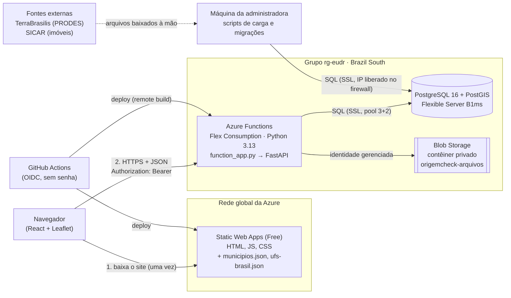
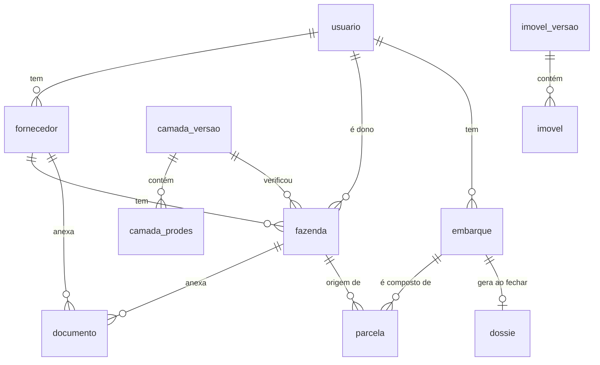
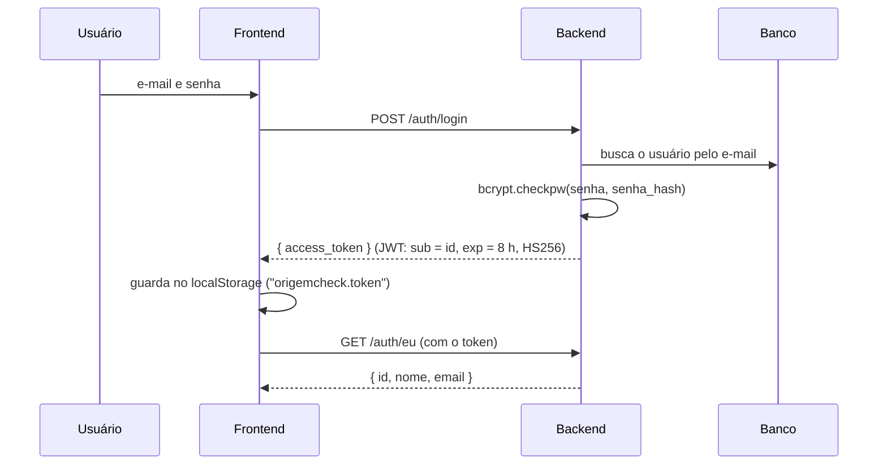
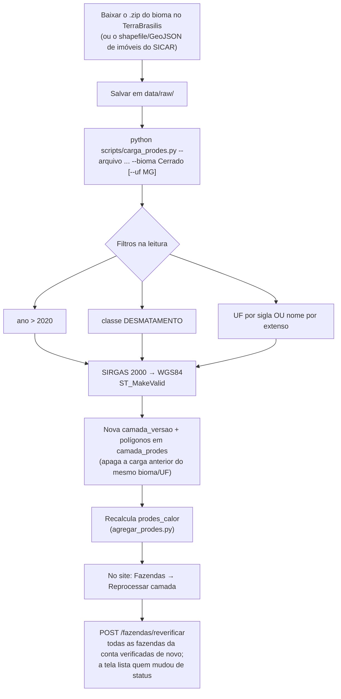
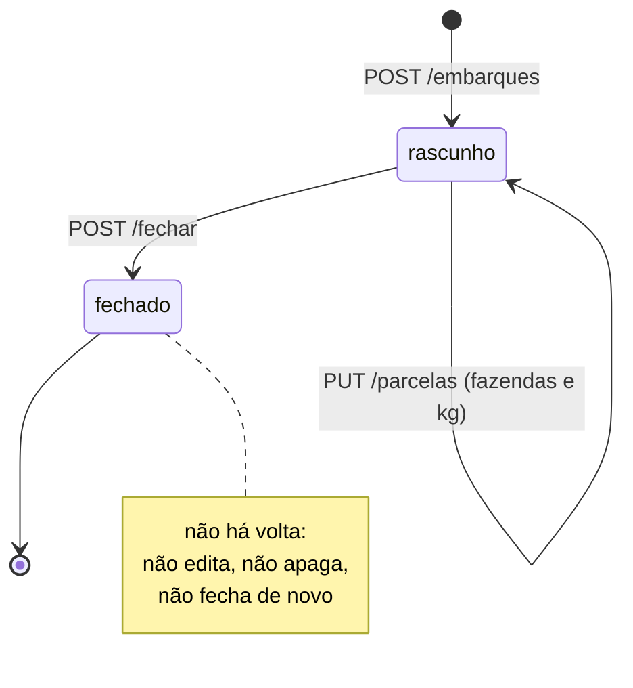
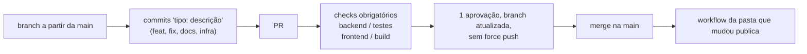
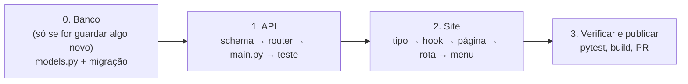
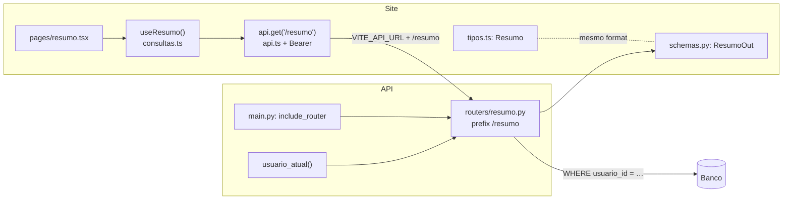

# Como o OrigemCheck funciona

Guia para entender o sistema de ponta a ponta. Ele cobre o que o sistema faz, como as peças estão montadas e
conversam, o que acontece em cada fluxo e como evoluí-lo. A seção 12 ensina, passo a passo, a criar uma página
nova e um endpoint novo.

As regras de negócio completas ficam em [context.md](../../context.md). Este documento explica **como** elas viraram
código.

> Situação descrita: novembro de 2026. Base: `main` no commit `2e560ba` (PRs #1 a #5 integrados), mais a branch
> `usabilidade-busca` (busca no mapa, município/UF com sugestões, CAR digitado).

Documentos irmãos:
- [BANCO-DE-DADOS.md](../../docs/BANCO-DE-DADOS.md): cada tabela, segurança, backup e consultas prontas.
- [DEPLOY-AZURE.md](../../docs/DEPLOY-AZURE.md): como os recursos foram criados e como publicar.
- [CONTRIBUTING.md](../../CONTRIBUTING.md): fluxo de branch, PR e revisão.

---

## Sumário

1. [O problema que o sistema resolve](#1-o-problema-que-o-sistema-resolve)
2. [Vocabulário](#2-vocabulário)
3. [Arquitetura](#3-arquitetura)
4. [O banco de dados](#4-o-banco-de-dados)
5. [O backend (API)](#5-o-backend-api)
6. [O frontend (site)](#6-o-frontend-site)
7. [Os fluxos, passo a passo](#7-os-fluxos-passo-a-passo)
8. [As regras de negócio e onde elas moram no código](#8-as-regras-de-negócio-e-onde-elas-moram-no-código)
9. [Rodando localmente x rodando no Azure](#9-rodando-localmente-x-rodando-no-azure)
10. [CI/CD, testes e operação](#10-cicd-testes-e-operação)
11. [O que está feito, o que foi verificado e o que falta](#11-o-que-está-feito-o-que-foi-verificado-e-o-que-falta)
12. [Como criar uma página nova e um endpoint novo](#12-como-criar-uma-página-nova-e-um-endpoint-novo)
13. [Onde mexer para…](#13-onde-mexer-para)

---

## 1. O problema que o sistema resolve

A partir de 30/12/2026 (30/06/2027 para micro e pequenas empresas), quem coloca café no mercado da União Europeia
precisa provar, **para cada carga**, que o café não veio de área desmatada depois de **31/12/2020**. A exigência
vem do Regulamento UE 2023/1115, a EUDR, alterado pelo 2025/2650. O importador europeu repassa essa exigência ao
exportador brasileiro por contrato. Ele pede, para cada remessa:

1. a geolocalização de cada área de origem;
2. evidência de que não houve desmatamento depois da data de corte;
3. evidência de legalidade.

O cenário-alvo é um exportador de café de médio porte, com cerca de 15 embarques por mês, que hoje controla tudo em
planilha e e-mail. Esse jeito tem três fragilidades:

- **Técnica:** cruzar polígonos com o mapa de desmatamento exige um sistema de informação geográfica (SIG).
- **Controle:** nada impede uma fazenda com problema de entrar no embarque.
- **Prova:** se o mapa oficial muda depois, a planilha não registra o que se sabia no dia do embarque.

O OrigemCheck faz três coisas para o exportador:

1. **Cadastra** de onde vem o café: fornecedores e suas fazendas, com o desenho da área no mapa.
2. **Verifica sozinho** se cada fazenda tem desmatamento posterior a 2020. Para isso, cruza o desenho com o mapa
   oficial de desmatamento do INPE (PRODES).
3. **Gera a prova** de cada embarque: um dossiê com as fazendas de origem, em GeoJSON (para o sistema do importador)
   e em PDF (para leitura humana). O dossiê **não muda depois**.

**Fora do escopo, por decisão:**
- balanço de massa (mistura de lotes);
- outras camadas: embargos do Ibama, terras indígenas, unidades de conservação;
- portal do importador;
- perfis de usuário e trilha de auditoria;
- filas e jobs em segundo plano;
- IA e OCR.

---

## 2. Vocabulário

| Termo | O que significa aqui |
|---|---|
| **Exportador / usuário / conta** | Quem usa o sistema. Cada conta é um exportador e só enxerga os próprios dados. |
| **Fornecedor** | Produtor ou cooperativa que vende café ao exportador. Identificado por CPF ou CNPJ (com dígitos verificadores conferidos). |
| **Fazenda** | Área produtiva de um fornecedor, **com desenho no mapa**: um polígono, ou um ponto se tiver até 4 ha. É ela que é verificada e tem status. |
| **Status da fazenda** | `apta` (pode compor embarque), `bloqueada` (sobrepõe desmatamento pós-2020 acima da tolerância) ou `pendente`. |
| **Parcela** | Uma parte de um embarque: "X kg vieram da fazenda Y". Cada parcela vem de uma única fazenda. |
| **Embarque** | Uma remessa para a UE, composta de parcelas. Nasce como `rascunho` e é `fechado` uma única vez. |
| **Dossiê** | A prova de origem de um embarque fechado: um **retrato congelado** dos dados no instante do fechamento. |
| **PRODES** | Mapeamento anual de desmatamento do INPE. Cada polígono diz onde e em que ano houve supressão de vegetação nativa. |
| **Camada** | Dado de referência comum a todas as contas, carregado por script (PRODES, imóveis do CAR). Cada carga gera uma **versão**. |
| **CAR** | Cadastro Ambiental Rural. O código do imóvel tem o formato `UF-IBGE7-hash`, por exemplo `SP-3500105-…`. |
| **Imóvel do CAR** | Contorno oficial de um imóvel rural, numa camada **de referência comum a todos** (cinza no mapa). Não tem fornecedor nem status e não entra em embarque. Só vira **fazenda** quando um exportador o escolhe em "Nova fazenda → Imóvel do CAR" e salva. A partir daí o desenho é copiado e verificado no PRODES como o de qualquer fazenda. |
| **Mapa de calor** | Visão afastada do desmatamento, em células quadradas de cor sólida, vinda da tabela pré-somada `prodes_calor`. |
| **Tolerância** | `TOLERANCIA_M2` (padrão 1.000 m²): sobreposição menor que isso não bloqueia. |
| **GeoJSON** | Formato de texto (JSON) para desenhos no mapa. É a "língua" que frontend e backend usam para geometrias. |
| **SRID 4326 / WGS84** | O sistema de coordenadas usado em todo o sistema: longitude e latitude em graus. |
| **bbox** | Retângulo do mapa, no formato `oeste,sul,leste,norte` em graus. O mapa manda o bbox para pedir só o que está na tela. |

---

## 3. Arquitetura

### 3.1 A ideia em uma frase

O sistema tem **três camadas**: site estático, API sem estado e banco geográfico. **O site nunca fala com o banco;
só a API fala.** Arquivos (documentos, PDFs, GeoJSON dos dossiês) ficam num armazenamento de objetos, também
acessado apenas pela API.

Uma analogia que ajuda:
- **site** = salão e cardápio do restaurante (onde você vê e clica);
- **API** = garçom e cozinha (recebe o pedido, confere as regras, faz o trabalho);
- **banco** = despensa e arquivo de fichas;
- **Blob Storage** = armário de pastas.

O cliente nunca entra na cozinha.

### 3.2 Visão física (Azure)



| Recurso | Nome | Configuração | Por que este |
|---|---|---|---|
| Grupo de recursos | `rg-eudr` | assinatura Azure for Students | Agrupa tudo; apagar o grupo apaga o sistema inteiro. |
| Site | `swa-origemcheck-lslater26` | Static Web Apps, plano Free, East US 2 | Só serve arquivos estáticos. O serviço não existe em Brazil South, mas a entrega é por rede global, então não fica lento. |
| API | `func-origemcheck-lslater26` | Functions Flex Consumption, Python 3.13, 512 MB, até 5 instâncias, 0 sempre prontas | Paga por execução, com cota grátis de 250 mil execuções e 100 mil GB-s por mês. O plano gratuito do App Service estourava a cota. |
| Banco | `pg-origemcheck-lslater26` | PostgreSQL Flexible Server, Burstable B1ms, 32 GB, PG 16 + PostGIS | O único recurso cobrado por hora ligado (~US$ 20–25/mês). Pode ser desligado. |
| Arquivos | `storigemchecklslater26` | Storage Standard LRS, TLS 1.2, contêiner privado | O disco de uma Function é temporário e há várias instâncias, então os arquivos não podem morar nele. |
| Identidade de deploy | `id-github-origemcheck` | identidade gerenciada com credencial federada (OIDC) | O GitHub publica sem nenhuma senha guardada. |

### 3.3 O caminho de uma requisição, camada por camada

Exemplo: o quadro de fazendas pede `GET /fazendas`.

```mermaid
sequenceDiagram
    autonumber
    participant N as Navegador
    participant H as Host do Functions
    participant A as AsgiFunctionApp
    participant F as FastAPI
    participant D as Dependências<br/>(get_db, usuario_atual)
    participant R as Router fazendas.py
    participant P as Pool SQLAlchemy
    participant DB as PostgreSQL

    N->>H: OPTIONS /fazendas (preflight CORS)
    H-->>N: 204 + Access-Control-Allow-* (a plataforma responde; o FastAPI nem roda)
    N->>H: GET /fazendas + Authorization: Bearer <jwt>
    Note over H: instância parada? cold start (alguns segundos)
    H->>A: requisição HTTP (routePrefix "", sem /api)
    A->>F: converte para ASGI
    F->>D: resolve as dependências da rota
    D->>P: get_db() pega uma conexão do pool
    D->>D: usuario_atual() valida assinatura e expiração do JWT
    D->>DB: SELECT usuario WHERE id = sub
    F->>R: listar(db, usuario)
    R->>DB: SELECT ... FROM fazenda WHERE usuario_id = :u (+ ST_AsGeoJSON)
    DB-->>R: linhas
    R-->>F: lista de objetos
    F->>F: valida a saída com response_model (Pydantic)
    F-->>N: 200 + JSON
    D->>P: finally: db.close() devolve a conexão
```

O que cada passo garante:

- **Preflight (1–2):** o site está numa origem (`*.azurestaticapps.net`) e a API em outra
  (`*.azurewebsites.net`). Como o pedido leva o cabeçalho `Authorization`, o navegador pergunta antes com um
  `OPTIONS`. No Azure quem responde é a **plataforma** da Function, configurada com `az functionapp cors add`.
  Por isso `CORS_ORIGENS` fica vazio no FastAPI de produção: configurar nos dois lugares duplicaria o cabeçalho, e
  o navegador recusa cabeçalho duplicado. Localmente quem responde é o `CORSMiddleware`, com cache de preflight de
  2 h.
- **Cold start (4):** com zero instâncias sempre prontas, a primeira chamada depois de um tempo parado sobe uma
  instância nova. O frontend tolera isso: o React Query refaz até 2 vezes os erros que não são 4xx.
- **Embrulho (5–6):** [backend/function_app.py](../../backend/function_app.py) tem uma linha útil:
  `func.AsgiFunctionApp(app=fastapi_app, http_auth_level=ANONYMOUS)`. É o **mesmo** objeto FastAPI que roda com
  `uvicorn` no desenvolvimento. A Function é anônima porque a autenticação é o JWT do próprio sistema.
- **Dependências (7–10):** o FastAPI injeta `get_db` (uma sessão do banco por requisição, sempre fechada no
  `finally`) e `usuario_atual` (401 se o token faltar, estiver vencido ou adulterado).
- **Router (11–13):** a consulta **sempre** filtra por `usuario_id` (regra R6).
- **Saída (14):** o `response_model` filtra e valida o JSON de saída, então campo interno não vaza.

### 3.4 Contratos entre as camadas

| Fronteira | Contrato | Onde está definido |
|---|---|---|
| Site → API | URL base + rota + JSON | `VITE_API_URL` (lido em [lib/api.ts](../../frontend/src/lib/api.ts)) e os `prefix` dos routers |
| Formato dos dados | Schema Pydantic no back = interface TypeScript no front, **mesmos nomes de campo** | [schemas.py](../../backend/app/schemas.py) ↔ [lib/tipos.ts](../../frontend/src/lib/tipos.ts) |
| Autenticação | `Authorization: Bearer <JWT HS256, 8 h>` | [auth.py](../../backend/app/auth.py) ↔ `requisitar()` em `api.ts` |
| Erros | Código HTTP + `{"detail": "mensagem em português"}`; 422 traz uma lista de campos | `HTTPException` nos routers ↔ `mensagemDeErro()` em `api.ts` |
| Geometrias | GeoJSON em SRID 4326 | `services/geometria.py` ↔ `lib/geo.ts` e os mapas |
| API → banco | ORM (SQLAlchemy 2) e SQL espacial | [models.py](../../backend/app/models.py) + migrações Alembic |
| API → arquivos | `salvar` / `ler` / `apagar` por caminho lógico | [services/arquivos.py](../../backend/app/services/arquivos.py) |

### 3.5 Por que cada escolha (e o que ela custa)

| Escolha | Motivo | Custo / contrapartida |
|---|---|---|
| **PostgreSQL + PostGIS** para verificar | A pergunta é "este desenho cruza algum dos 863 mil polígonos, e em quantos m²?". O índice espacial **GiST** vai direto aos candidatos próximos: ~0,1 s por fazenda (medido de 6 a 161 ms). | O banco é a parte cara e precisa estar ligado. |
| **Azure Functions Flex** | Paga por execução, com cota grátis. O App Service gratuito estourava. | Cold start. Cada requisição conta na cota, por isso o frontend economiza chamadas (cache, nada de polling). |
| **FastAPI + Pydantic** | Validação declarativa e documentação OpenAPI automática em `/docs`. | — |
| **React 18 + TS + Vite + Tailwind** | Componentes, tipagem e um build estático que cabe no SWA grátis. | Pacote JS > 500 kB (aviso no build). |
| **Leaflet + React-Leaflet** | Mapas sem chave paga. O editor de geometria é **próprio**, porque o `leaflet-draw` está abandonado e quebra em ESM. | Mais código nosso para manter. |
| **React Query** | Cache de 5 min, sem refetch ao focar a janela: menos chamadas, menos execuções. | É preciso **invalidar** as chaves certas depois de gravar. |
| **Blob com identidade gerenciada** | Instâncias efêmeras e múltiplas. Sem chave guardada: a Function tem o papel *Storage Blob Data Contributor*. | Localmente usa disco (`STORAGE_BACKEND=local`). |
| **JWT próprio** (e não Entra ID) | A conta de estudante não registra aplicativos no Entra ID, e o escopo é um login por exportador, sem perfis. | Sem recuperação de senha nem limite de tentativas. Token no `localStorage` (risco em caso de XSS). |
| **Retrato JSONB no dossiê** | A prova precisa ficar congelada (R3). | Os dados ficam duplicados (proposital). |
| **Alembic** | O esquema só muda por migração, então o banco local é igual ao do Azure. | Migração na Azure é aplicada **à mão, antes do merge**: o runner do GitHub não tem IP fixo para o firewall. |
| **Site chamando a Function direto** | O SWA Free não vincula uma Function como back-end (só o Standard). | Exige CORS (seção 3.3). |
| **Arquivos estáticos para IBGE** (`municipios.json`, `ufs-brasil.json`) | Ficam em `frontend/public/` e são servidos pelo SWA: **zero execução** de Function. | ~320 KB, baixados só quando alguma tela precisa. |

---

## 4. O banco de dados

> Guia completo (cada tabela, segurança, backup e consultas prontas): [BANCO-DE-DADOS.md](../../docs/BANCO-DE-DADOS.md).

### 4.1 Duas famílias de tabelas

PostgreSQL 16 + PostGIS 3.4. Toda geometria em SRID 4326.

**Família 1: dados de cada exportador (tabelas mutáveis).** Mudam o tempo todo pelo uso do site, **sempre via
API**, e cada linha tem dono (`usuario_id`).

**Família 2: camadas de referência.** Representam o mapa oficial em forma de tabela. São comuns a todas as contas,
ninguém as edita pelo site, e só mudam por script de carga.

Uma analogia: as tabelas mutáveis são o caderno de trabalho da empresa; as camadas são o livro da biblioteca, que
só a bibliotecária troca.



| Tabela | Família | Guarda | Campos que importam |
|---|---|---|---|
| `usuario` | exportador | As contas | `email` único, `senha_hash` (bcrypt), `nome` |
| `fornecedor` | exportador | Produtores e cooperativas | `documento` (CPF/CNPJ, único por conta), `tipo_pessoa` PF/PJ, contato, `municipio`, `uf`, `ativo` |
| `fazenda` | exportador | As áreas produtivas | `geom` (Polygon/MultiPolygon/Point, GiST), `status`, `area_sobreposta_m2`, `verificada_em`, `camada_versao_id`, `car_codigo` (único por conta), CCIR, NIRF, matrícula, `area_declarada_ha` |
| `documento` | exportador | Anexos | dono = fornecedor **ou** fazenda (exatamente um), `tipo`, `validade`, `caminho_storage`, `sha256` |
| `embarque` | exportador | Remessas | `identificacao` (única por conta), data, destino, `status` (`rascunho`/`fechado`), `fechado_em` |
| `parcela` | exportador | Itens do embarque | `fazenda_id` (ON DELETE RESTRICT), `quantidade_kg > 0` |
| `dossie` | exportador, mas **imutável** | A prova | `retrato` (JSONB), caminhos do GeoJSON e do PDF; um por embarque |
| `camada_versao` | camada | Carimbo de cada carga do PRODES | bioma, UF, arquivo, `n_feicoes`, `carregada_em` |
| `camada_prodes` | camada | ~863 mil polígonos de desmatamento 2021–2026 (735 MB, quase todo o banco) | `geom` (GiST), `ano`, `area_km`, `versao_id` |
| `prodes_calor` | camada (derivada) | Desmatamento somado em células, para o mapa de calor | `nivel` (0 = 0,25°; 1 = 0,05°), `lat`, `lon`, `area_ha`. São ~7,8 mil células no nível 0 e ~101 mil no nível 1 |
| `imovel_versao` / `imovel` | camada | Base de imóveis do CAR | `cod_imovel` (único), `municipio`, `uf`, `area_ha`, `situacao`, `geom` (GiST) |
| `alembic_version` | controle | Em qual migração o banco está | — |

### 4.2 Por que PostGIS e como a conta é feita

Uma coluna `geom` não guarda texto: guarda uma **geometria**, e o banco sabe fazer contas com ela.

- `ST_Intersects(a, b)` responde se os dois desenhos se tocam. **Usa o índice GiST**, então com 863 mil polígonos o
  banco só olha os que estão perto.
- `ST_Intersection(a, b)` devolve a parte em comum.
- `ST_Area(x::geography)` dá a área em **m²**. O cast `::geography` é obrigatório: sem ele a área sai em "graus ao
  quadrado", um número como 0,0003 que não significa nada.
- `ST_MakeValid` conserta desenho com autointerseção.
- `ST_SimplifyPreserveTopology` simplifica polígonos antes de mandá-los ao mapa.

### 4.3 Quem cria e quem altera

- **Esquema:** só pelas migrações do Alembic, em
  [backend/alembic/versions/](../../backend/alembic/versions/): `0001_baseline`, `0002_imoveis`,
  `0003_prodes_calor`. Para criar tudo do zero: `alembic upgrade head`. No CI, o `alembic check` falha se alguém
  mudou `models.py` sem gerar migração.
- **Dados mutáveis:** só a API.
- **Camadas:** só os scripts de carga, com o usuário de banco `carga`. Ele pode fazer
  SELECT/INSERT/UPDATE/DELETE apenas nas tabelas de camada e **não enxerga** contas, fazendas, embarques nem
  dossiês. Ver [infra/papel-carga.sql](../../infra/papel-carga.sql); o teste `test_papel_carga.py` confere isso.

| Quem | Usuário de banco | Pode |
|---|---|---|
| Usuário do site | nenhum | Nada direto. Pede à API, que só mostra e altera linhas da conta dele. |
| API local | `eudr` (do `.env`, Docker na porta 5433) | Tabelas mutáveis |
| API no Azure | `eudradmin` | Tabelas mutáveis. Ter um usuário só para a aplicação seria uma melhoria de menor privilégio. |
| Scripts de carga | `carga` | Só as tabelas de camada |
| Administradora | `eudradmin` | Migrações, firewall, cargas |

Barreiras de rede no Azure:
- o firewall nega tudo, exceto serviços do Azure e IPs liberados;
- SSL obrigatório;
- senhas só em `.env`, `.env.azure` (permissão 600) e nas App Settings;
- backup diário com retenção de 7 dias.

### 4.4 Garantias que o próprio banco dá

Estas regras estão no banco, não só no código, para não haver dado inconsistente nem por engano:

- **Chave estrangeira composta** `(fornecedor_id, usuario_id)`: uma fazenda só aponta para um fornecedor **da
  mesma conta**.
- `parcela.fazenda_id ON DELETE RESTRICT`: uma fazenda usada em embarque não pode ser apagada (a API traduz isso
  em 409).
- **UNIQUE:**
  - e-mail;
  - CAR por conta;
  - CPF/CNPJ por conta;
  - identificação do embarque por conta;
  - dossiê por embarque;
  - `cod_imovel`.
- **CHECK:**
  - `status` só nos valores válidos;
  - `quantidade_kg > 0`;
  - documento com exatamente um dono.

---

## 5. O backend (API)

### 5.1 Tecnologia e organização

FastAPI, SQLAlchemy 2 + GeoAlchemy2, Pydantic 2 e pydantic-settings, Alembic, `python-jose` (JWT), `bcrypt`,
`azure-storage-blob` + `azure-identity` e ReportLab (PDF). O que vai para a Function está em
[requirements.txt](../../backend/requirements.txt). Testes e scripts (geopandas, pyogrio, pytest) ficam em
`requirements-dev.txt` e não sobem.

```
backend/
├─ function_app.py      ponto de entrada do Azure Functions: embrulha app.main:app
├─ host.json            timeout 3m30s, routePrefix "" (sem /api), amostragem do App Insights
├─ alembic/             migrações (o histórico do esquema)
├─ app/
│  ├─ main.py           cria o FastAPI, CORS, include_router de cada router, /health e /health/db
│  ├─ config.py         Settings (pydantic-settings) lidas do .env ou das App Settings
│  ├─ database.py       engine com pool, SessionLocal e a dependência get_db()
│  ├─ auth.py           bcrypt, criar_token() e a dependência usuario_atual()
│  ├─ models.py         tabelas ORM, restrições e índices
│  ├─ schemas.py        formatos de entrada (…In, …Update) e saída (…Out); validação de CPF/CNPJ e senha
│  ├─ routers/          a camada HTTP, um arquivo por assunto
│  │  ├─ auth.py           /auth/registrar, /auth/login, /auth/eu
│  │  ├─ fornecedores.py   CRUD + obter_fornecedor() (o modelo de filtro por conta)
│  │  ├─ fazendas.py       CRUD, import-geojson, verificar, reverificar
│  │  ├─ documentos.py     upload multipart, download, exclusão
│  │  ├─ embarques.py      CRUD, parcelas, fechar (com SELECT … FOR UPDATE)
│  │  ├─ dossies.py        leitura do retrato e downloads
│  │  ├─ camada.py         versão, recorte do PRODES, mapa de calor
│  │  └─ imoveis.py        recorte e detalhe dos imóveis do CAR
│  └─ services/         regras que não são só "salvar e devolver"
│     ├─ geometria.py      valida e conserta o GeoJSON recebido; aplica os limites
│     ├─ verificacao.py    verificar_fazenda(): a checagem contra o PRODES
│     ├─ dossie.py         montar_retrato(), montar_geojson(), montar_pdf()
│     └─ arquivos.py       BackendDisco (dev/testes) e BackendBlob (produção)
├─ scripts/             carga_prodes.py, carga_imoveis.py, agregar_prodes.py, seed.py, seed_imoveis.py, sicar.py
└─ tests/               pytest contra PostGIS real
```

**Router x service:** o router cuida do HTTP: o que chegou, quem é o usuário, qual código devolver e quando fazer
commit. O service cuida da regra. Por isso criar, editar, importar e reprocessar uma fazenda chamam todos a
**mesma** `verificar_fazenda()`.

### 5.2 Configuração

[config.py](../../backend/app/config.py) define uma classe `Settings`. Cada campo vira uma variável de ambiente com o
mesmo nome em maiúsculas. Localmente ela é lida do `.env` na raiz; no Azure, das *App Settings* da Function.

| Variável | Padrão | Para quê |
|---|---|---|
| `DATABASE_URL` | (obrigatória) | Conexão com o banco |
| `JWT_SECRET`, `JWT_EXPIRA_MINUTOS` | —, 480 | Assinatura e validade do token |
| `TOLERANCIA_M2` | 1000 | Regra R5 |
| `ANO_CORTE` | 2020 | Só conta desmatamento com `ano > 2020` |
| `STORAGE_BACKEND` | `local` | `local` (disco) ou `blob` |
| `BLOB_ACCOUNT_URL`, `BLOB_CONTAINER` | —, `origemcheck-arquivos` | Blob com identidade gerenciada |
| `UPLOAD_MAX_MB` | 10 | Tamanho máximo de anexo |
| `DB_POOL_SIZE`, `DB_MAX_OVERFLOW` | 3, 2 | Conexões por instância. Com até 5 instâncias, o máximo é 25, abaixo do limite de ~50 do B1ms. |
| `CORS_ORIGENS` | `http://localhost:5173` | **Vazio no Azure** (seção 3.3) |

O engine ([database.py](../../backend/app/database.py)) usa:
- `pool_pre_ping` e `pool_recycle=300`, porque o Azure derruba conexões ociosas;
- `connect_timeout=10`: com o banco inacessível, a requisição falha rápido em vez de gastar GB-s até o timeout.

### 5.3 Padrões que todo router segue

Estes padrões são o "jeito da casa". Um endpoint novo deve repeti-los (seção 12).

1. **Dependências na assinatura:**
   `db: Session = Depends(get_db), usuario: Usuario = Depends(usuario_atual)`.
   Toda rota fora de `/auth/registrar`, `/auth/login` e `/health*` exige login.
2. **Filtro por conta em toda consulta** (R6). Para buscar um recurso por id, existe uma função `obter_…` que
   filtra por `usuario_id` e levanta 404:
   ```python
   def obter_fornecedor(db, usuario, fornecedor_id):
       fornecedor = db.scalar(select(Fornecedor).where(
           Fornecedor.id == fornecedor_id, Fornecedor.usuario_id == usuario.id))
       if fornecedor is None:
           raise HTTPException(404, detail="Fornecedor não encontrado.")
       return fornecedor
   ```
   Recurso de outra conta responde **404, nunca 403**, porque um 403 confirmaria que o recurso existe.
3. **Schemas separados:** `…In` (criar), `…Update` (todos os campos opcionais, aplicados com
   `model_dump(exclude_unset=True)`) e `…Out` (saída, com `from_attributes`). O decorator declara
   `response_model=…Out` e `status_code` (201 ao criar, 204 ao excluir).
4. **Commit no router**, uma transação por requisição. Os services fazem `flush`, mas nunca `commit`, para que
   "salvar + verificar" seja tudo ou nada (R1).
5. **Unicidade e integridade pelo banco:** `try: db.commit() except IntegrityError: db.rollback(); raise
   HTTPException(409, …)`.
6. **Erros em português, dizendo o que fazer:** `HTTPException(400 | 404 | 409 | 503, detail="…")`. O frontend
   mostra o `detail` exatamente como vem.
7. **Cache HTTP só onde é seguro:** o recorte da camada usa `Cache-Control: private, max-age=3600`, porque a URL
   leva `?v=<versão>`; `/camada/versao` usa `no-store`.
8. **Rotas fixas antes das rotas com parâmetro:** `/fazendas/import-geojson` e `/fazendas/reverificar` estão
   declaradas antes de `/fazendas/{fazenda_id}`, senão o FastAPI tentaria ler "reverificar" como id.

### 5.4 Códigos de resposta

| Código | Quando |
|---|---|
| 200 / 201 / 204 | OK / criado (`POST /fazendas` devolve a fazenda já verificada) / excluído, sem corpo |
| 400 | Geometria ruim, fazenda não apta no embarque, embarque vazio, bbox inválido ou grande demais, formato de arquivo |
| 401 | Sem token, token vencido ou adulterado (com o cabeçalho `WWW-Authenticate: Bearer`) |
| 403 | **Não é usado** (R6) |
| 404 | Não existe **ou** é de outra conta. Também acontece quando falta `include_router` para uma rota nova. |
| 409 | E-mail, CAR ou CPF/CNPJ repetido; fornecedor com fazendas; fazenda em embarque; embarque já fechado |
| 410 | O registro existe, mas o arquivo sumiu do armazenamento |
| 413 | Upload maior que 10 MB |
| 422 | Corpo fora do schema Pydantic (campo faltando, tipo errado, CPF inválido) |
| 503 | Não há camada PRODES carregada para verificar (R1) |

### 5.5 A API completa

Documentação interativa em `http://localhost:8000/docs` (local) ou `…azurewebsites.net/docs`. Para testar as rotas
protegidas, use o botão **Authorize** com o token do `/auth/login`.

| Área | Endpoints |
|---|---|
| Saúde (públicos) | `GET /health`, `GET /health/db` (faz `SELECT 1`; usado pelo smoke test do deploy) |
| Conta | `POST /auth/registrar` (público), `POST /auth/login` (público), `GET /auth/eu` |
| Fornecedores | `GET/POST /fornecedores`, `GET/PUT/DELETE /fornecedores/{id}` |
| Fazendas | `GET/POST /fazendas`, `GET/PUT/DELETE /fazendas/{id}`, `POST /fazendas/import-geojson`, `POST /fazendas/{id}/verificar`, `POST /fazendas/reverificar` |
| Documentos | `GET/POST /fornecedores/{id}/documentos`, `GET/POST /fazendas/{id}/documentos`, `GET /documentos/{id}/arquivo`, `DELETE /documentos/{id}` |
| Embarques | `GET/POST /embarques`, `GET/PUT/DELETE /embarques/{id}`, `PUT /embarques/{id}/parcelas`, `POST /embarques/{id}/fechar` |
| Dossiês | `GET /dossies`, `GET /dossies/{id}`, `GET /dossies/{id}/geojson`, `GET /dossies/{id}/pdf` |
| Camada | `GET /camada/versao`, `GET /camada/prodes?bbox=` (até 3.000 polígonos simplificados; bbox ≤ 4 graus²), `GET /camada/prodes/calor?nivel=0\|1&bbox=` |
| Imóveis do CAR | `GET /imoveis?bbox=` (contornos, usado a partir do zoom 12), `GET /imoveis/{cod_imovel}` |

---

## 6. O frontend (site)

### 6.1 Tecnologia e organização

React 18 + TypeScript 5, Vite 6, Tailwind 4 (com componentes no estilo shadcn em `components/ui/`),
React Router 6, React Query 5, React Hook Form, Leaflet 1.9 + React-Leaflet 4 e ícones `lucide-react`. O alias
`@/` aponta para `frontend/src/` ([vite.config.ts](../../frontend/vite.config.ts)).

```
frontend/
├─ public/
│  ├─ staticwebapp.config.json   rotas do SWA: tudo que não é arquivo vai para index.html
│  ├─ municipios.json            5.570 municípios do IBGE (nome, UF, lat, lon) para sugestões e busca
│  └─ ufs-brasil.json            divisas dos estados (malha IBGE)
└─ src/
   ├─ main.tsx          QueryClient, BrowserRouter, AuthProvider
   ├─ App.tsx           a tabela de rotas e a guarda Protegida
   ├─ index.css         Tailwind e estilos globais
   ├─ lib/
   │  ├─ api.ts            ÚNICO lugar que faz fetch: base URL, token, erros, downloads
   │  ├─ auth.tsx          AuthProvider e useSessao(): token, usuário logado, entrar, sair
   │  ├─ consultas.ts      chaves de cache e hooks React Query (useFazendas, useEmbarque…)
   │  ├─ tipos.ts          interfaces espelho dos schemas …Out da API
   │  ├─ status.ts         cor e rótulo de cada status
   │  ├─ formato.ts        hectares, kg, datas, CPF/CNPJ no padrão brasileiro
   │  ├─ geo.ts            utilidades de geometria (área de um anel em ha, limites para enquadrar, centro padrão)
   │  ├─ localidades.ts    UFS, useLocalidades(), buscarMunicipios(), normalizar() sem acento
   │  └─ utils.ts          cn() para juntar classes Tailwind
   ├─ components/
   │  ├─ layout.tsx        cabeçalho com o menu (array NAVEGACAO) e <Outlet/> das páginas
   │  ├─ comum.tsx         Painel, FaixaTitulo, CabecalhoPagina, Mensagem, Carregando, Campo, Dado, StatusPill
   │  ├─ campos-fornecedor.tsx, campos-fazenda.tsx   campos de formulário reaproveitados (criar e editar)
   │  ├─ campos-localidade.tsx   município com sugestões + UF em lista
   │  ├─ editor-geometria.tsx    desenhar polígono ou ponto, ou adotar um imóvel do CAR
   │  ├─ documentos.tsx    lista, envio e download de anexos
   │  └─ ui/
   │     ├─ button.tsx, input.tsx, label.tsx, autocompletar.tsx
   │     ├─ fazendas-board.tsx            o quadro principal (lista com filtros + mapa)
   │     └─ fazendas-board-utils/mapa.tsx mapa base, panes, calor, PRODES, imóveis, divisas, busca, legenda
   └─ pages/            uma tela por rota (export default)
```

### 6.2 Inicialização e roteamento

1. [main.tsx](../../frontend/src/main.tsx) importa o CSS do Leaflet (sem ele os tiles ficam desalinhados) e cria o
   `QueryClient` com três regras:
   - `staleTime` de 5 min: a resposta é reaproveitada sem nova chamada;
   - `refetchOnWindowFocus: false`;
   - `retry` até 2 vezes, **só** para erros que não são 4xx. Isso cobre o cold start, mas não insiste num 404.
2. Em volta do app ficam, nesta ordem: `QueryClientProvider` → `BrowserRouter` → `AuthProvider` → `App`.
3. [App.tsx](../../frontend/src/App.tsx):
   - `/login` é pública;
   - todas as outras rotas ficam **dentro** de `<Route element={<Protegida/>}>`;
   - `Protegida` manda para `/login` quem não tem token e, para quem tem, renderiza o `Layout` (menu + `<Outlet/>`);
   - `/` e qualquer rota desconhecida redirecionam para `/fazendas`.
4. No Azure, o `staticwebapp.config.json` reescreve qualquer URL que não seja arquivo para `/index.html`. Assim
   abrir `/fazendas/12` direto funciona, e quem resolve a rota é o React Router. Os `.json` estão excluídos dessa
   regra para os arquivos do IBGE serem servidos.

| Rota | Arquivo | O que dá para fazer |
|---|---|---|
| `/login` | `pages/login.tsx` | Entrar ou criar conta |
| `/fazendas` | `pages/fazendas.tsx` → `fazendas-board.tsx` | Lista filtrável por status + mapa; importar GeoJSON; reprocessar a camada |
| `/fazendas/nova` | `pages/fazenda-nova.tsx` | Desenhar, marcar ponto ou adotar imóvel do CAR (clicando ou digitando o código); ao salvar, a verificação roda |
| `/fazendas/:id` | `pages/fazenda-detalhe.tsx` | Status em destaque, dados, redesenhar, reverificar, documentos |
| `/fornecedores`, `/fornecedores/:id` | `pages/fornecedores.tsx`, `fornecedor-detalhe.tsx` | Cadastro (município/UF com sugestões), fazendas do fornecedor, documentos |
| `/embarques`, `/embarques/:id` | `pages/embarques.tsx`, `embarque-detalhe.tsx` | Compor parcelas (bloqueadas aparecem desabilitadas, com o motivo), fechar, baixar evidências |
| `/dossies`, `/dossies/:id` | `pages/dossies.tsx`, `dossie-detalhe.tsx` | Auditoria do retrato congelado, com mapa e downloads |

### 6.3 Como o frontend conversa com o backend

- **Endereço:** `VITE_API_URL`. O valor é embutido no JavaScript **na hora do build**, então mudar o endereço exige
  um build novo. Localmente o padrão é `http://localhost:8000`. No CI, o build da `main` falha se a variável estiver
  vazia, para não publicar um site apontando para localhost.
- **`api.ts`:** expõe `api.get`, `api.post`, `api.put`, `api.delete` e `api.baixar`. Toda chamada:
  - põe `Authorization: Bearer` se houver token;
  - manda JSON, ou `FormData` sem `Content-Type` (o navegador põe o boundary);
  - num 401, apaga o token e dispara o evento `origemcheck:sessao-expirada`. O `AuthProvider` escuta, limpa o cache
    do React Query e a rota `Protegida` leva ao login;
  - num erro, lança `ApiErro(status, mensagem)`. A mensagem é o `detail` da API, ou a lista de campos de um 422
    traduzida para texto;
  - numa falha de rede, usa status 0: "Não foi possível falar com o servidor".
- **Downloads** (documentos, PDF, GeoJSON) precisam do token, então um `<a href>` simples não funcionaria.
  `api.baixar()` busca o arquivo como blob, lê o nome em `Content-Disposition` e dispara o download.
- **Sessão:** `useSessao()` devolve `{autenticado, usuario, entrar, registrar, sair}`. O usuário vem de
  `GET /auth/eu`, com cache infinito enquanto o token for o mesmo.

### 6.4 Dados e cache (React Query)

[consultas.ts](../../frontend/src/lib/consultas.ts) concentra as **chaves** e os **hooks de leitura**:

```ts
export const chaves = {
  fornecedores: ["fornecedores"], fazendas: ["fazendas"], embarques: ["embarques"], dossies: ["dossies"],
  documentos: (dono, id) => ["documentos", dono, id],
};
export const useFazendas = () =>
  useQuery({ queryKey: chaves.fazendas, queryFn: () => api.get<Fazenda[]>("/fazendas") });
```

- **Leitura:** a página chama o hook e usa `{ data, isLoading, error }`.
- **Escrita:** `useMutation` com a chamada à API. No `onSuccess`, **invalida** o que mudou.
  `useInvalidarCadastro()` invalida fazendas, fornecedores e embarques juntos, porque as contagens e os status de
  uns dependem dos outros.
- **Dossiê:** usa `staleTime: Infinity`, porque é imutável (R3).
- **Dados estáticos** (municípios, divisas) também passam pelo React Query, com `staleTime` e `gcTime` infinitos.
  Só são baixados quando alguma tela precisa (o campo de busca baixa a lista ao ganhar foco).

### 6.5 O mapa por dentro

Todos os mapas usam o componente `Mapa` de
[fazendas-board-utils/mapa.tsx](../../frontend/src/components/ui/fazendas-board-utils/mapa.tsx). Ele monta o mapa
base (claro Esri, ruas OSM ou satélite), cria **panes** (camadas de desenho com `z-index` fixo, para a ordem nunca
depender de quem carregou primeiro) e coloca a busca e as divisas.

| Pane | z-index | O que desenha |
|---|---|---|
| `calor` | 340 | Mapa de calor em grade (classe `GradeCalor`, um `L.GridLayer` que pinta cada célula num canvas) |
| `supressao` | 350 | Polígonos do PRODES, com hachura vermelha |
| `imoveis` | 360 | Contornos cinza dos imóveis do CAR |
| `divisas` | 370 | Divisas dos estados (sempre visíveis) |
| `overlayPane` (padrão do Leaflet) | 400 | As fazendas, coloridas por status |

O que aparece em cada zoom:

| Zoom | O que aparece | Requisição |
|---|---|---|
| 0–6 | Calor nível 0, células de 0,25° (~28 km), Brasil inteiro | `GET /camada/prodes/calor?nivel=0&bbox=<Brasil>` (uma só) |
| 7–9 | Calor nível 1, células de 0,05° (~5,5 km), só o recorte visível | `GET /camada/prodes/calor?nivel=1&bbox=…` |
| 10+ | Polígonos reais do PRODES | `GET /camada/prodes?bbox=…&v=<versão>`, com o bbox arredondado numa grade de 0,25° para reaproveitar respostas |
| 12+ com o chip "Imóveis CAR" | Contornos dos imóveis | `GET /imoveis?bbox=…` |

As cores do calor são 5 faixas sólidas, sem degradê, calculadas em relação ao **percentil 95** dos hectares no
recorte (`max` na resposta). Assim, poucas células enormes não apagam o resto.

Cores das fazendas: **verde** = apta, **vermelho** = bloqueada, **cinza tracejado** = pendente; ponto = círculo com
anel tracejado. O status é codificado na cor do traço, nunca só em texto. O sócio que consulta pelo celular precisa
entender em dois segundos.

---

## 7. Os fluxos, passo a passo

### 7.1 Entrar no sistema



A senha nunca é guardada: o banco tem só o hash bcrypt, com salt. A senha precisa ter de 8 a 72 caracteres; 72 é o
limite do bcrypt.

### 7.2 Cadastrar uma fazenda (e a verificação automática)

Este é o coração do sistema.

```mermaid
sequenceDiagram
    participant U as Usuário
    participant F as Frontend
    participant B as Router fazendas.py
    participant G as geometria.py
    participant V as verificacao.py
    participant DB as Banco (PostGIS)

    U->>F: desenha, marca ponto ou adota imóvel do CAR; preenche os dados
    F->>B: POST /fazendas { fornecedor_id, nome, geometry, car_codigo, ... }
    B->>B: usuario_atual() + obter_fornecedor() (o fornecedor é seu? senão 404)
    B->>G: validar_geometria()
    G->>DB: ST_GeomFromGeoJSON, ST_MakeValid, ST_Area(::geography)
    G-->>B: ok (ou 400: linha, vazia, área zero, > 100.000 ha, ponto > 4 ha ou sem área declarada)
    B->>DB: INSERT fazenda (pendente) + flush
    B->>V: verificar_fazenda()
    V->>DB: existe PRODES com ano > 2020? (senão 503 e rollback)
    V->>DB: soma da interseção em m² (ou, se ponto, "cai dentro?")
    V->>V: ≥ TOLERANCIA_M2 → bloqueada; senão apta
    V->>DB: UPDATE status, area_sobreposta_m2, verificada_em, camada_versao_id
    B->>DB: COMMIT único
    B-->>F: 201 + fazenda já com status
    F-->>U: abre o detalhe: APTA (verde) ou BLOQUEADA (vermelho)
```

A consulta central:

```sql
SELECT COALESCE(SUM(ST_Area(ST_Intersection(f.geom, d.geom)::geography)), 0)
FROM fazenda f
JOIN camada_prodes d ON ST_Intersects(f.geom, d.geom)   -- o índice GiST entra aqui
WHERE f.id = :id AND d.ano > :corte;
```

Detalhes que valem entender:

- **Salvar e verificar acontecem na mesma transação** (R1). Se a verificação falhar, nada fica salvo. Nunca existe
  fazenda "cadastrada mas não verificada" escondida.
- **Camada vazia → 503.** Sem PRODES, a verificação recusa em vez de aprovar tudo, porque um "apta" falso seria o
  pior erro possível.
- **Tolerância de 1.000 m²:** traço impreciso na borda gera sobreposição pequena sem significado. A área fica
  registrada mesmo quando não bloqueia.
- **Ponto (até 4 ha):** não tem área, então o critério é binário; cair dentro de um polígono de desmatamento
  bloqueia. A tolerância não se aplica.
- **Editar** (`PUT`) só reverifica quando a geometria muda.
- **Importar GeoJSON:** lê `cod_imovel`, `municipio` e `num_area`, os nomes de campo usados pelo SICAR. É tudo ou
  nada: se uma feição falhar, nenhuma é gravada.
- **Três jeitos de desenhar** (`editor-geometria.tsx`):
  1. **polígono**, clicando nos cantos;
  2. **ponto**;
  3. **imóvel do CAR**, clicando no contorno cinza (zoom ≥ 12) ou **digitando o código**. O código digitado é posto
     em maiúsculas e perde espaços e pontos; depois a tela busca `GET /imoveis/{cod}`, preenche CAR, município, UF
     e área, e leva o mapa até o imóvel.

  O desenho do imóvel é **copiado** para a fazenda, que passa a ter vida própria.

### 7.3 Carregar camadas e reprocessar

O PRODES e o CAR não entram pela tela, porque são grandes demais: entram por script, no terminal.



- **Por que o botão Reprocessar existe:** a verificação automática roda quando a fazenda é salva. Como a carga
  acontece fora do app, uma camada nova não reverifica sozinha as fazendas antigas. **Dossiês já fechados não
  mudam.**
- **A UF por sigla ou por nome** corrigiu um defeito real: o Cerrado mineiro vinha com o nome por extenso, e a
  carga aproveitava só 49 de 48.749 polígonos.
- **`carga_imoveis.py`:** lê em lotes (pyarrow), faz upsert por `cod_imovel` e, se a conexão cair no meio, refaz o
  lote, com até 3 tentativas e reconexão.
- **Situação atual:**
  - PRODES: seis biomas, **863.255 polígonos** de 2021 a 2026;
  - imóveis do CAR: PE completo (435 mil), MA e RS parciais (159 mil e 362 mil);
  - detalhes e a lacuna da Amazônia em [context.md](../../context.md).

### 7.4 O mapa, a busca e os cadastros com sugestão

- **Primeira chamada:** `GET /camada/versao`, uma vez por sessão. O número da carga vai na URL dos recortes
  (`&v=8`), então uma carga nova muda a URL e o navegador não usa a camada velha do cache.
- **Busca no mapa** (canto superior esquerdo de todos os mapas). Aceita:
  - **município** (sem precisar de acento): aproxima no município;
  - **estado** ("minas"): enquadra a divisa do IBGE;
  - **código do CAR** (`UF-1234567-…`): `GET /imoveis/{cod}`, enquadra e destaca o contorno tracejado;
  - **coordenadas** (`-21.68, -51.07`; se vierem invertidas como lon, lat, são trocadas): vai ao ponto e põe um
    marcador.

  Só o CAR chama a API; município e estado vêm do arquivo estático. Funciona pelo teclado: setas, Enter e Esc.
- **Município e UF nos formulários** (`campos-localidade.tsx`):
  - a UF é uma lista com os 27 estados;
  - o município mostra sugestões filtradas pela UF escolhida;
  - escolher um município preenche a UF;
  - o texto continua livre (as sugestões ajudam, não obrigam);
  - uma UF antiga fora da lista continua visível.

### 7.5 Documentos

1. Na fazenda ou no fornecedor, o usuário escolhe o tipo (CAR, CCIR, matrícula, licença, contrato), a validade e o
   arquivo.
2. O frontend envia `multipart/form-data`.
3. O backend confere:
   - o **conteúdo**, pelos primeiros bytes (PDF, PNG ou JPEG), não o nome;
   - o limite de 10 MB (senão 413);
   - o nome do arquivo, reduzido ao nome base, para não escapar da pasta.
4. Calcula o **SHA-256**, uma "impressão digital" do arquivo.
5. Grava com nome aleatório (UUID): em `backend/storage/` localmente, ou no **Blob** privado no Azure.
6. Guarda no banco só os metadados e o caminho.

O SHA-256 vai para o dossiê: se alguém trocar o arquivo depois, dá para provar que não é o mesmo.

### 7.6 Embarque, fechamento e dossiê



1. **Criar:** identificação (única na conta), data, destino. O embarque nasce como rascunho.
2. **Compor** (`PUT /embarques/{id}/parcelas`): para cada fazenda, quantos kg. O **servidor** recusa:
   - com 400 nomeando as fazendas, qualquer uma que não esteja apta (R2);
   - fazenda repetida;
   - fazenda de outra conta;
   - kg ≤ 0.

   Na tela, as bloqueadas aparecem desabilitadas com o motivo, mas **quem decide é o servidor**: burlar a tela não
   adianta.
3. **Fechar** (`POST /embarques/{id}/fechar`):
   1. trava a linha com `SELECT … FOR UPDATE`, para que dois cliques simultâneos não fechem duas vezes;
   2. confere: é da conta? (senão 404) é rascunho? (senão 409) tem parcela? (senão 400);
   3. **revalida** que todas continuam aptas, porque uma carga nova pode ter bloqueado alguma desde a composição;
   4. `montar_retrato()` **copia** desenhos, CAR, status, área sobreposta, data da verificação, versão da camada,
      kg e documentos com SHA-256;
   5. `montar_geojson()` e `montar_pdf()` (ReportLab) geram os arquivos, e `arquivos.salvar()` os grava;
   6. INSERT do dossiê, status `fechado`, `fechado_em`, COMMIT;
   7. se algo falhar no meio: ROLLBACK e os arquivos já gravados são apagados.

**Por que copiar em vez de só apontar para as fazendas (R3):** se o PRODES for atualizado em junho e uma fazenda
virar bloqueada, o dossiê de abril precisa continuar mostrando o que se sabia em abril. Um registro que muda sozinho
não serve como prova. Há um teste que verifica exatamente isso.

---

## 8. As regras de negócio e onde elas moram no código

| Regra | Em uma frase | Onde está | Teste que garante |
|---|---|---|---|
| **R1** Verificação automática | Salvar ou mudar o desenho já verifica, na mesma transação; sem camada, 503 | `services/verificacao.py`, chamado de `routers/fazendas.py` | `test_verificacao.py` |
| **R2** Bloqueio no servidor | Fazenda não apta não entra em embarque; o fechamento revalida | `validar_fazendas_aptas()` em `routers/embarques.py` | `test_embarques.py` |
| **R3** Dossiê congelado | O dossiê copia os dados do dia do fechamento | `services/dossie.py` (`montar_retrato`) | `test_embarques.py` ("PRODES mudou e o dossiê não") |
| **R4** Ponto até 4 ha | Ponto só para áreas pequenas; critério binário | `services/geometria.py` e `services/verificacao.py` | `test_verificacao.py` |
| **R5** Tolerância | Sobreposição abaixo de 1.000 m² não bloqueia, mas fica registrada | `TOLERANCIA_M2` em `config.py`, usada em `verificacao.py` | `test_verificacao.py` |
| **R6** Cada um vê o seu | Toda consulta filtra pela conta; recurso alheio dá 404 | `obter_…()` de cada router + FK composta no banco | `test_isolamento_entre_usuarios`, `test_documento_de_outro_usuario_da_404`, `test_dossie_de_outro_usuario_da_404` |

Outras regras:
- só conta a classe DESMATAMENTO com ano > 2020;
- CAR e CPF/CNPJ são únicos por conta;
- fazenda em embarque não pode ser excluída;
- embarque fechado é imutável;
- geometria acima de 100.000 ha é recusada.

---

## 9. Rodando localmente x rodando no Azure

O **mesmo código** roda nos dois lugares. O que muda é quem o hospeda, onde ficam os arquivos e de onde vem a
configuração.

| | Local (desenvolvimento) | Azure (produção) |
|---|---|---|
| Frontend | `npm run dev` (Vite, porta 5173) | Static Web Apps, plano Free |
| Backend | `uvicorn app.main:app --reload` (porta 8000) | Azure Functions Flex, Python 3.13, via `function_app.py` |
| Banco | PostgreSQL 16 + PostGIS 3.4 no Docker (porta 5433) | Azure Database for PostgreSQL Flexible Server B1ms |
| Arquivos | `backend/storage/` (`STORAGE_BACKEND=local`) | Blob Storage (`STORAGE_BACKEND=blob`, identidade gerenciada) |
| Configuração | `.env` na raiz | App Settings da Function; variáveis do GitHub no build do site |
| CORS | `CORSMiddleware` do FastAPI | Plataforma da Function (`CORS_ORIGENS` vazio) |
| Esquema | `alembic upgrade head` | O mesmo comando, à mão, com `DATABASE_URL` do Azure, **antes** do merge |

### Como rodar localmente

```bash
# Terminal 1: banco e backend
cd ~/Desktop/Sistema-Rastreabilidade-EUDR
docker compose up -d                       # PostgreSQL + PostGIS na porta 5433
cd backend && source .venv/bin/activate
alembic upgrade head                       # cria/atualiza as tabelas
python scripts/carga_prodes.py --arquivo ../data/processed/MataAtlantica_desmatamento_SP.json \
       --bioma "Mata Atlantica" --uf SP    # camada de exemplo (sem ela, cadastrar fazenda dá 503)
python scripts/seed.py                     # conta demo, 4 fazendas em Adamantina/SP, EMB-DEMO-001
uvicorn app.main:app --reload              # http://localhost:8000/docs

# Terminal 2: frontend
cd ~/Desktop/Sistema-Rastreabilidade-EUDR/frontend
npm install && npm run dev                 # http://localhost:5173
```

Conta de demonstração: `demo@exemplo.com.br` / `demo-origemcheck-2026`.

Com imóveis do CAR carregados, `python scripts/seed_imoveis.py` cria as fazendas de demonstração de PE, MA e RS
(2 aptas + 1 bloqueada por estado) e o embarque `EMB-DEMO-002`.

`python scripts/sicar.py` abre um guia de estudo do projeto no terminal: tópicos, busca e uma prova de 15 questões.

---

## 10. CI/CD, testes e operação

### 10.1 Fluxo de mudança



- **[backend.yml](../../.github/workflows/backend.yml):**
  - **job `testes`** (roda em todo PR): sobe `postgis/postgis:16-3.4`, remove as extensões que a Azure não tem
    (`postgis_tiger_geocoder`, `postgis_topology`, `fuzzystrmatch`), roda o pytest e depois
    `alembic upgrade head && alembic check`;
  - **job `deploy`** (só na `main`, depende de `testes`, environment `production`): login na Azure por OIDC,
    `Azure/functions-action` com remote build (Flex, `.funcignore`) e um smoke test em `/health/db` (até 20
    tentativas a cada 15 s).
- **[frontend.yml](../../.github/workflows/frontend.yml):** `npm ci` e `npm run build` (que inclui `tsc -b`, a checagem
  de tipos). Na `main`, confere `VITE_API_URL`, guarda `dist/` como artefato por 7 dias e publica no SWA com o token
  do deploy.
- **Gatilhos:**
  - todo PR roda os dois workflows, sem filtro de pasta, porque são checks obrigatórios;
  - um push na `main` só roda o workflow da pasta que mudou;
  - também dá para disparar à mão (`workflow_dispatch`);
  - execuções antigas do mesmo PR são canceladas.

### 10.2 Testes

- **pytest contra PostGIS real**, não simulado, porque a corretude depende das funções espaciais.
- O `conftest.py`:
  - recria o banco `eudr_test` e aplica as migrações uma vez por sessão;
  - esvazia as tabelas (`TRUNCATE … RESTART IDENTITY`) antes de cada teste.
- O `TestClient` faz requisições HTTP reais ao app.
- **Fixtures:**
  - `client`;
  - `auth` (usuária A) e `auth_b` (usuária B), que retornam o cabeçalho `Authorization` pronto;
  - `camada`: supressão sintética de 2022, com ~1 km² e área conhecida, para resultados exatos;
  - `fornecedor`;
  - o helper `quadrado(lon, lat, lado)`.
- **Números:** 13 arquivos, 112 casos passando, `alembic check` sem diferenças.
- **Defeitos que viraram teste:**
  - `test_uf_por_sigla_ou_por_nome_por_extenso`;
  - `test_versao_da_camada_muda_a_cada_carga`;
  - `test_queda_de_conexao_no_meio_repete_o_lote`.
- **Frontend:** não tem testes automatizados. A garantia é a checagem de tipos no build e o teste manual do roteiro
  de demonstração: desenhar sobre desmatamento → bloqueio → recusa no embarque → incluir as aptas → fechar →
  baixar.

### 10.3 Operação

- **Saúde:** `/health` (o app está no ar) e `/health/db` (o banco responde).
- **Logs:** Application Insights, com amostragem; as requisições ficam fora da amostragem.
- **Sem monitor periódico**, porque cada checagem custaria execuções.
- **Custo:** de zero a ~US$ 25/mês, quase tudo do banco. Desligar o banco quando não estiver em uso (o site abre,
  mas o login falha). Alerta de orçamento recomendado em US$ 50.
- **Rollback:**
  - reverter o commit por PR, o que gera um novo deploy;
  - ou publicar à mão (`func azure functionapp publish` ou a CLI do SWA) a partir de um commit anterior.

---

## 11. O que está feito, o que foi verificado e o que falta

### Pronto e verificado

| O quê | Como foi verificado |
|---|---|
| Cadastro de fornecedores (CPF/CNPJ validado), fazendas e documentos | Testes automáticos + navegador |
| Verificação automática com tolerância, ponto até 4 ha e recusa sem camada | Testes com camada sintética de área conhecida |
| Bloqueio no servidor e dossiê congelado (GeoJSON + PDF) | Testes, incluindo "PRODES mudou e o dossiê não" |
| Isolamento entre contas (404) | Testes com duas usuárias |
| Importação de GeoJSON (tudo ou nada) | Testes |
| Carga do PRODES (seis biomas, 863 mil polígonos) e de imóveis do CAR, com repetição de lote | Testes + cargas reais no Azure |
| Mapa de calor em grade sólida, divisas dos estados, imóveis do CAR | Testes de API + navegador nos zooms 4, 5, 7, 10 e 12 |
| Busca no mapa; município/UF com sugestões; CAR digitado na nova fazenda | Navegador (branch `usabilidade-busca`) |
| Fazendas de demonstração em SP, PE, MA e RS | `seed.py` + `seed_imoveis.py` no Azure |
| Sistema **no ar no Azure** | Login, fazendas, mapa, documentos no Blob e dossiê testados em produção |

### Pontos de atenção

- **Deploy automático do backend:** as execuções na `main` passam nos testes, mas falham no smoke test, embora a API
  publicada responda `/health/db` = reachable. A causa ainda não foi identificada. O frontend publica normalmente.
- **Amazônia:** só o PRODES preliminar de 2026 está carregado. Sem o histórico 2021–2025, desmatamento desses anos
  na Amazônia não bloqueia.
- **Só PRODES:** não há comparação com o mapa de cobertura florestal 2020 do JRC, a referência do lado europeu.
- **Imóveis do CAR de MA e RS** estão parciais.
- **Conta única por empresa:** sem perfis, sem recuperação de senha, sem limite de tentativas de login.
- **React Router 6:** dois alertas moderados que só se resolvem na versão 7.
- **PDF:** decimais com ponto e vírgula misturados, horário em UTC sem fuso.
- **`func start`** (rodar como Function na máquina) não foi testado.

---

## 12. Como criar uma página nova e um endpoint novo

Exemplo completo, para servir de molde. Vamos criar uma página **"Resumo"** com:
- quantas fazendas estão aptas, bloqueadas e pendentes;
- quantos embarques estão em rascunho.

Ela **não existe** no projeto hoje.

**A ordem é sempre banco → API → site.** Cada camada só depende da que vem antes, então dá para testar cada passo
isolado.



### Passo 0 — O banco precisa mudar?

Para o Resumo, **não**: ele só lê tabelas que já existem. Se fosse guardar algo novo (uma coluna `observacao` na
fazenda, por exemplo):

1. Editar a classe em [models.py](../../backend/app/models.py), de preferência com uma coluna que aceita vazio
   (`nullable=True`), para o código antigo continuar funcionando.
2. Gerar a migração:
   ```bash
   cd backend
   alembic revision --autogenerate -m "observacao da fazenda"
   ```
3. **Abrir e conferir** o arquivo gerado em `alembic/versions/`. O autogenerate erra com tipos espaciais e índices
   GiST.
4. Aplicar e conferir: `alembic upgrade head && alembic check` (deve dizer que não há diferenças).
5. Se for uma **tabela de camada**, dar o GRANT ao usuário `carga` em
   [infra/papel-carga.sql](../../infra/papel-carga.sql).
6. **No Azure:** aplicar à mão, **antes** do merge, com a URL de administrador (ver
   [DEPLOY-AZURE.md](../../docs/DEPLOY-AZURE.md)). O runner do GitHub não passa pelo firewall, por isso o deploy não migra.
   Durante alguns minutos o código antigo convive com o esquema novo, e por isso a migração tem de ser compatível
   com ele.

### Passo 1 — O endpoint no backend

**1a. O formato da resposta** em [schemas.py](../../backend/app/schemas.py):

```python
class ResumoOut(BaseModel):
    aptas: int
    bloqueadas: int
    pendentes: int
    embarques_em_rascunho: int
```

Este schema é o **contrato**: os nomes de campo aqui serão os mesmos na interface TypeScript.

**1b. O router.** Criar `backend/app/routers/resumo.py`:

```python
from fastapi import APIRouter, Depends
from sqlalchemy import func, select
from sqlalchemy.orm import Session

from app.auth import usuario_atual
from app.database import get_db
from app.models import Embarque, Fazenda, Usuario
from app.schemas import ResumoOut

router = APIRouter(prefix="/resumo", tags=["resumo"])


@router.get("", response_model=ResumoOut)
def obter(db: Session = Depends(get_db), usuario: Usuario = Depends(usuario_atual)):
    """Contagens da conta logada para a página Resumo."""
    por_status = dict(
        db.execute(
            select(Fazenda.status, func.count())
            .where(Fazenda.usuario_id == usuario.id)  # R6: SEMPRE filtrar pela conta
            .group_by(Fazenda.status)
        ).all()
    )
    rascunhos = db.scalar(
        select(func.count())
        .select_from(Embarque)
        .where(Embarque.usuario_id == usuario.id, Embarque.status == "rascunho")
    )
    return ResumoOut(
        aptas=por_status.get("apta", 0),
        bloqueadas=por_status.get("bloqueada", 0),
        pendentes=por_status.get("pendente", 0),
        embarques_em_rascunho=rascunhos or 0,
    )
```

O que cada linha garante:
- `prefix="/resumo"`: o endereço final é o prefixo + o caminho do decorator (`""`), ou seja, `GET /resumo`.
- `tags`: o agrupamento no `/docs`.
- `Depends(usuario_atual)`: sem token, a resposta é 401 antes de a função rodar.
- `.where(… usuario_id == usuario.id)`: **a linha mais importante**. Sem ela, a conta veria números das outras.
- `response_model=ResumoOut`: valida a saída e documenta a rota.

Se a rota **gravasse** algo (POST/PUT/DELETE), o molde seria:

```python
@router.post("", response_model=AlgoOut, status_code=201)
def criar(dados: AlgoIn, db: Session = Depends(get_db), usuario: Usuario = Depends(usuario_atual)):
    algo = Algo(**dados.model_dump(), usuario_id=usuario.id)
    db.add(algo)
    try:
        db.commit()
    except IntegrityError:
        db.rollback()
        raise HTTPException(409, detail="Já existe … na sua conta.")
    return algo
```

Para editar ou excluir um recurso, buscar primeiro com uma função `obter_algo(db, usuario, id)` que filtra pela
conta e levanta 404, como `obter_fornecedor()`. Uma regra violada vira `HTTPException(400 ou 409, detail="mensagem
em português dizendo o que fazer")`, e o frontend mostra esse texto na tela sem tradução.

**1c. Registrar o router** em [main.py](../../backend/app/main.py). **Sem este passo, a rota dá 404.**

```python
from app.routers import auth, camada, documentos, dossies, embarques, fazendas, fornecedores, imoveis, resumo
...
app.include_router(resumo.router)
```

**1d. Os testes.** Criar `backend/tests/test_resumo.py`, usando as fixtures do `conftest.py`:

```python
from tests.conftest import quadrado


def test_resumo_exige_login(client):
    assert client.get("/resumo").status_code == 401


def test_resumo_conta_por_status(client, auth, camada, fornecedor):
    # uma fazenda longe da supressão (apta) e uma em cima dela (bloqueada)
    for nome, geom in (("Longe", quadrado(-49.0, -20.0, 0.01)), ("Em cima", quadrado(-50.0, -21.0, 0.01))):
        r = client.post("/fazendas", json={"fornecedor_id": fornecedor["id"], "nome": nome, "geometry": geom},
                        headers=auth)
        assert r.status_code == 201, r.text

    r = client.get("/resumo", headers=auth)
    assert r.status_code == 200
    assert r.json() == {"aptas": 1, "bloqueadas": 1, "pendentes": 0, "embarques_em_rascunho": 0}


def test_resumo_nao_mistura_contas(client, auth, auth_b, camada, fornecedor):
    client.post("/fazendas", json={"fornecedor_id": fornecedor["id"], "nome": "X",
                                   "geometry": quadrado(-49.0, -20.0, 0.01)}, headers=auth)
    assert client.get("/resumo", headers=auth_b).json()["aptas"] == 0  # R6
```

Rodar e testar:

```bash
cd backend
python -m pytest tests -q              # todos devem passar
uvicorn app.main:app --reload          # http://localhost:8000/docs → Authorize → GET /resumo → Try it out
```

### Passo 2 — A página no frontend

**2a. O tipo** em [lib/tipos.ts](../../frontend/src/lib/tipos.ts), com **os mesmos nomes** do `ResumoOut`:

```ts
export interface Resumo {
  aptas: number;
  bloqueadas: number;
  pendentes: number;
  embarques_em_rascunho: number;
}
```

**2b. A chave e o hook** em [lib/consultas.ts](../../frontend/src/lib/consultas.ts):

```ts
export const chaves = {
  // ...as que já existem
  resumo: ["resumo"] as const,
};

export const useResumo = () =>
  useQuery({ queryKey: chaves.resumo, queryFn: () => api.get<Resumo>("/resumo") });
```

No mesmo arquivo, **incluir a chave nova** em `useInvalidarCadastro()`. Ela é chamada depois de criar, editar ou
excluir fazendas e embarques. Sem isso, o Resumo mostraria um número velho por até 5 minutos (o `staleTime`).

```ts
queryClient.invalidateQueries({ queryKey: chaves.resumo }),
```

**2c. A página.** Criar `frontend/src/pages/resumo.tsx` com os componentes de [comum.tsx](../../frontend/src/components/comum.tsx):

```tsx
import { LayoutDashboard } from "lucide-react";
import { CabecalhoPagina, Carregando, Dado, FaixaTitulo, Mensagem, Painel } from "@/components/comum";
import { useResumo } from "@/lib/consultas";

export default function PaginaResumo() {
  const { data, isLoading, error } = useResumo();
  return (
    <>
      <CabecalhoPagina titulo="Resumo" subtitulo="Situação das suas fazendas e embarques." />
      {error ? <Mensagem>{error.message}</Mensagem> : null}
      <Painel>
        <FaixaTitulo icone={<LayoutDashboard size={13} aria-hidden="true" />}>RESUMO</FaixaTitulo>
        {isLoading ? <Carregando /> : null}
        {data ? (
          <div className="grid grid-cols-2 gap-4 px-5 py-4 sm:grid-cols-4">
            <Dado rotulo="Aptas">{data.aptas}</Dado>
            <Dado rotulo="Bloqueadas">{data.bloqueadas}</Dado>
            <Dado rotulo="Pendentes">{data.pendentes}</Dado>
            <Dado rotulo="Embarques em rascunho">{data.embarques_em_rascunho}</Dado>
          </div>
        ) : null}
      </Painel>
    </>
  );
}
```

O padrão de todas as páginas:
- cabeçalho;
- mensagem de erro (o `error.message` já vem em português do `api.ts`);
- "Carregando…";
- conteúdo em `Painel`.

Para cores de status, use `STATUS` de `lib/status.ts`, nunca uma cor escrita à mão.

**2d. A rota** em [App.tsx](../../frontend/src/App.tsx), **dentro** do bloco `Protegida`, para exigir login:

```tsx
import PaginaResumo from "@/pages/resumo";
...
<Route element={<Protegida />}>
  ...
  <Route path="/resumo" element={<PaginaResumo />} />
</Route>
```

Fora desse bloco, a página abriria sem login e as chamadas dariam 401.

**2e. O menu** em [layout.tsx](../../frontend/src/components/layout.tsx), no array `NAVEGACAO`:

```tsx
import { FileCheck2, LayoutDashboard, Ship, Sprout, Users } from "lucide-react";

const NAVEGACAO = [
  { para: "/resumo", rotulo: "Resumo", icone: LayoutDashboard },
  // ...as que já existem
];
```

**2f. Se a página gravasse algo**, o molde é o `NovoFornecedor` de `pages/fornecedores.tsx`:

```tsx
const invalidar = useInvalidarCadastro();
const form = useForm<CamposAlgo>({ defaultValues: algoVazio });
const criar = useMutation({
  mutationFn: (corpo: unknown) => api.post<Algo>("/algo", corpo),
  onSuccess: async (novo) => {
    await invalidar();             // recarrega as listas afetadas
    navegar(`/algo/${novo.id}`);
  },
});
// <form onSubmit={form.handleSubmit((c) => criar.mutate(c))}> ... {criar.error ? <Mensagem>{criar.error.message}</Mensagem> : null}
```

Rodar e conferir:

```bash
cd frontend
npm run dev        # abrir http://localhost:5173/resumo
npm run build      # antes do PR: checa os tipos (tsc -b) como o CI faz
```

### Passo 3 — Publicar

1. Criar uma branch a partir da `main` e fazer commits como `feat(resumo): endpoint e página de resumo`.
2. Abrir o PR. Os checks `backend / testes` e `frontend / build` precisam passar.
3. Se houve migração, aplicá-la no Azure **antes** do merge (passo 0.6).
4. Fazer o merge. O workflow da pasta que mudou publica (`backend.yml` para a Function, `frontend.yml` para o
   site). **O CORS não muda**: ele é configurado por origem, não por rota.

### Como as pontas se encontram



### Checklist e erros comuns

| Sintoma | Causa provável | Onde corrigir |
|---|---|---|
| 404 na rota nova | Faltou `include_router`, ou o caminho difere do `prefix` | `main.py`, o router |
| 401 | Sem token, ou a rota ficou fora de `Protegida` no site | `App.tsx` |
| 422 | O corpo enviado não bate com o schema `…In` | Formulário, `schemas.py` |
| Aparecem dados de outra conta | Faltou o filtro `usuario_id` | O router (e um teste com `auth_b`) |
| A tela não atualiza depois de salvar | Faltou invalidar a chave | `onSuccess` / `useInvalidarCadastro()` |
| Rota fixa "engolida" (`/fazendas/exportar` dá 422) | Foi declarada **depois** de `/fazendas/{fazenda_id}` | A ordem dos decorators no router |
| PR vermelho no `alembic check` | `models.py` mudou sem migração | `alembic revision --autogenerate` |
| Build vermelho no PR | Erro de tipo no TypeScript | `npm run build` localmente |
| Funciona local, falha no Azure com 500 logo após o deploy | A migração não foi aplicada no banco do Azure | Passo 0.6 |

---

## 13. Onde mexer para…

| Quero… | Arquivo |
|---|---|
| Mudar a regra de verificação | `backend/app/services/verificacao.py` |
| Mudar o que é aceito como geometria | `backend/app/services/geometria.py` |
| Mudar o conteúdo do dossiê ou do PDF | `backend/app/services/dossie.py` |
| Mudar a tolerância ou o ano de corte | `TOLERANCIA_M2` / `ANO_CORTE` (`.env` ou App Settings); padrões em `config.py` |
| Criar ou alterar tabela | `backend/app/models.py` + migração em `backend/alembic/versions/` (seção 12, passo 0) |
| Criar endpoint | `backend/app/routers/` + `main.py` + `schemas.py` + `tests/` (seção 12, passo 1) |
| Criar tela | `frontend/src/pages/` + `App.tsx` + `layout.tsx` + `consultas.ts` + `tipos.ts` (seção 12, passo 2) |
| Mudar cores de status | `frontend/src/lib/status.ts` |
| Mudar mapa, camadas, calor, legenda ou busca | `frontend/src/components/ui/fazendas-board-utils/mapa.tsx` |
| Mudar o quadro de fazendas | `frontend/src/components/ui/fazendas-board.tsx` |
| Mudar o desenho / adoção de imóvel | `frontend/src/components/editor-geometria.tsx`, `pages/fazenda-nova.tsx` |
| Mudar sugestões de município/UF | `frontend/src/lib/localidades.ts`, `components/campos-localidade.tsx` |
| Mudar mensagens de erro do site | `frontend/src/lib/api.ts` (`mensagemDeErro`) |
| Carregar outra camada do PRODES | `python scripts/carga_prodes.py --help` |
| Carregar imóveis do CAR | `python scripts/carga_imoveis.py --help` |
| Recriar dados de demonstração | `python scripts/seed.py` e `python scripts/seed_imoveis.py` |
| Mudar o deploy | `.github/workflows/backend.yml` e `frontend.yml`, `backend/host.json` |
| Estudar o projeto pelo terminal | `python scripts/sicar.py` |
