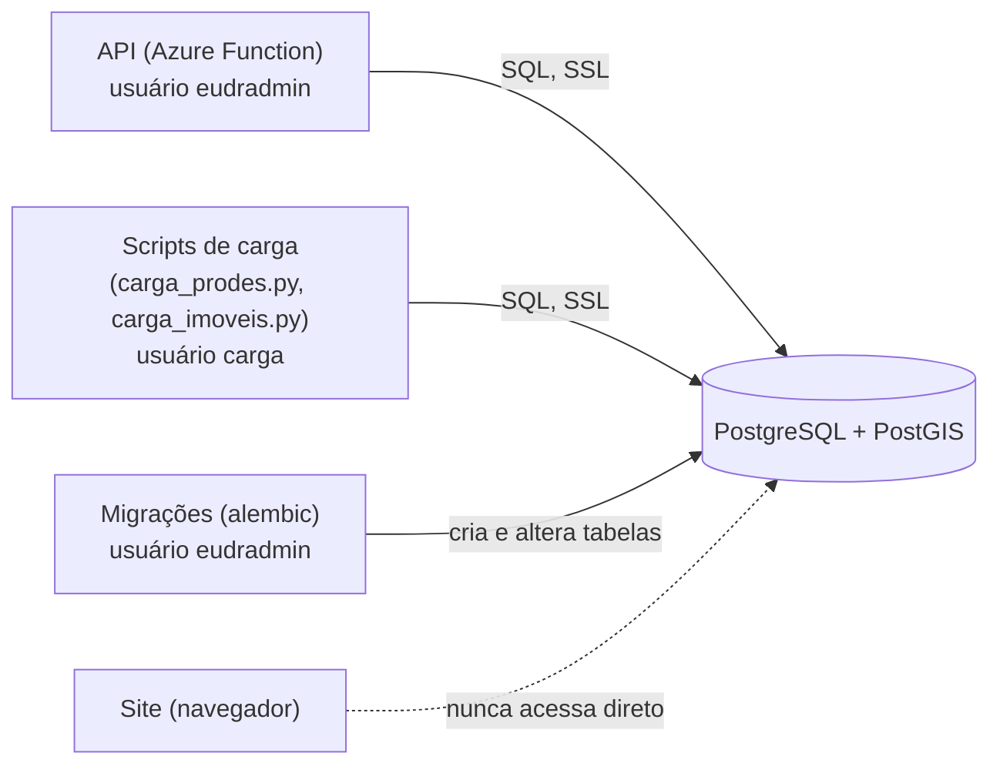
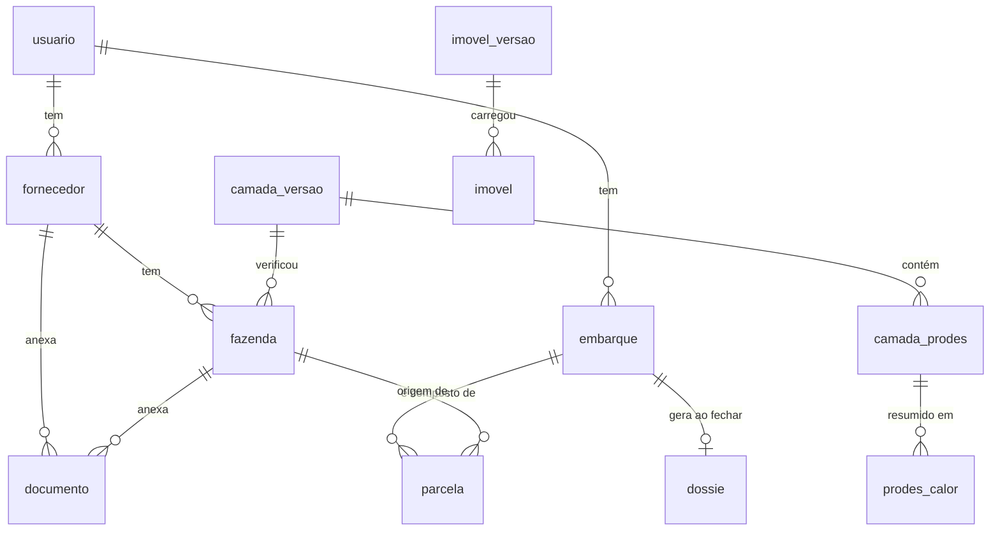

# O banco de dados do OrigemCheck

Guia funcional do banco: onde ele fica, como é organizado, o que cada tabela guarda, quem pode acessar e como
consultar. Para o sistema como um todo, veja [COMO-FUNCIONA.md](COMO-FUNCIONA.md).

> Situação descrita: novembro de 2026. As tabelas de **imóveis do CAR** (`imovel`, `imovel_versao`) vêm da
> migração `0002`, que está no PR `camada-imoveis`; elas existem no banco local, mas só chegam ao Azure depois do
> passo 9 do [DEPLOY-AZURE.md](DEPLOY-AZURE.md).

---

## 1. Em uma frase

É um **PostgreSQL 16 com a extensão PostGIS**, que guarda dois tipos de dado bem diferentes:

- **Dados de cada exportador** (contas, fornecedores, fazendas, documentos, embarques, dossiês): cada conta só
  enxerga os seus.
- **Camadas de referência comuns a todos** (desmatamento do PRODES, imóveis do CAR): mapas oficiais que entram
  por script e que todos os usuários consultam.

O PostGIS é o que transforma o PostgreSQL num banco "geográfico": ele guarda desenhos (polígonos e pontos) e sabe
responder perguntas como *"este desenho cruza aquele?"* e *"qual a área em comum?"*. É nessa conta que o sistema
descobre se uma fazenda tem desmatamento depois de 2020.

---

## 2. Onde ele está

Existem dois bancos com a **mesma estrutura**, criada pelas mesmas migrações:

| | Local (desenvolvimento) | Azure (produção) |
|---|---|---|
| Onde roda | Container Docker `eudr-db` no seu computador | Azure Database for PostgreSQL – Flexible Server `pg-origemcheck-lslater26` |
| Região | — | Brazil South |
| Tamanho da máquina | O que o Docker permitir | Burstable **B1ms** (1 vCPU, 2 GB de RAM), 32 GB de disco |
| Versões | PostgreSQL 16.4 + PostGIS 3.4 | PostgreSQL 16 + PostGIS |
| Endereço | `localhost:5433` | `pg-origemcheck-lslater26.postgres.database.azure.com:5432` |
| Nome do banco | `eudr` | `eudr` |
| Quem entra | Usuário `eudr` (do `.env`) | Administrador `eudradmin` (senha no `.env.azure`) e, depois do passo 9, o usuário `carga` |
| Conexão | Sem criptografia (é local) | **SSL obrigatório** (`?sslmode=require`) |
| Liga e desliga | `docker compose up -d` / `docker compose stop` | `az postgres flexible-server start` / `stop` |

O banco local usa a porta **5433** (e não a padrão, 5432) para não brigar com outro PostgreSQL instalado no Mac.
Os dados locais ficam num volume do Docker chamado `pgdata`: `docker compose down` **não** apaga, mas
`docker compose down -v` apaga tudo.

### Quem conversa com o banco



O site **nunca** fala com o banco: ele pede à API, e a API consulta o banco já filtrando pelo usuário logado.

---

## 3. Como ele está organizado

### 3.1 As duas famílias de tabelas



| Família | Tabelas | Tem dono? | Como entra |
|---|---|---|---|
| **Cadastro de cada exportador** | `usuario`, `fornecedor`, `fazenda`, `documento`, `embarque`, `parcela`, `dossie` | Sim: todas ligadas a um `usuario` | Pelo site |
| **Camadas de referência** | `camada_versao`, `camada_prodes`, `prodes_calor`, `imovel_versao`, `imovel` | Não: comuns a todos | Por script (`carga_*.py`, `agregar_prodes.py`) |
| **Controle** | `alembic_version` (versão das migrações), `spatial_ref_sys` (sistemas de coordenadas, do PostGIS) | — | Automático |

### 3.2 Volume atual

Números do banco local, que tem os mesmos dados que o Azure:

| Tabela | Linhas | Tamanho |
|---|---|---|
| `camada_prodes` | ~863 mil | 735 MB |
| `imovel` | ~1 mil (amostra de Adamantina, só local) | 1 MB |
| todas as tabelas de cadastro juntas | dezenas | < 1 MB |

Ou seja: **quase todo o banco é a camada do PRODES**. Os cadastros são minúsculos perto dela. Quando a base de
imóveis do CAR de estados inteiros entrar (Minas Gerais tem mais de 1 milhão de imóveis), ela passa a ser a maior tabela.

---

## 4. As tabelas, uma a uma

Convenções que valem para todas:

- `id` é um número sequencial gerado pelo banco.
- `criado_em` / `atualizado_em` são preenchidos sozinhos, com fuso horário.
- Toda coluna `geom` usa **SRID 4326**: longitude e latitude em graus (WGS84), o mesmo do GPS e do GeoJSON.

### 4.1 Cadastro de cada exportador

#### `usuario`: as contas
| Coluna | O que é |
|---|---|
| `email` | Login; **único** no sistema |
| `senha_hash` | A senha **embaralhada com bcrypt**. A senha original não é guardada em lugar nenhum. |
| `nome` | Nome exibido no site |

Cada conta é **um exportador** (regra R6). Não há perfis nem permissões dentro da conta.

#### `fornecedor`: quem vende o café
| Coluna | O que é |
|---|---|
| `usuario_id` | Dono (o exportador) |
| `documento` | CPF ou CNPJ, **só dígitos**, com dígitos verificadores conferidos; único **por conta** |
| `tipo_pessoa` | `PF` ou `PJ`, deduzido do tamanho do documento |
| `nome`, `email`, `telefone`, `municipio`, `uf`, `ativo` | Dados cadastrais |

Dois exportadores podem cadastrar o mesmo produtor: cada um tem o seu registro.

#### `fazenda`: a área verificada
É a tabela central do sistema.

| Coluna | O que é |
|---|---|
| `usuario_id`, `fornecedor_id` | Dono e fornecedor. O banco garante que o fornecedor é **do mesmo dono** (chave estrangeira composta). |
| `nome`, `car_codigo`, `ccir`, `nirf`, `matricula`, `municipio`, `uf` | Dados cadastrais. O `car_codigo` é único **por conta**. |
| `area_declarada_ha` | Área informada; obrigatória quando a fazenda é um ponto (regra R4: ponto só até 4 ha) |
| `geom` | O desenho: **polígono, multipolígono ou ponto** |
| `status` | `pendente`, `apta` ou `bloqueada` |
| `area_sobreposta_m2` | Quanto do desenho cai sobre desmatamento pós-2020 |
| `verificada_em` | Quando foi verificada |
| `camada_versao_id` | Qual carga do PRODES foi usada na verificação |

`status`, `area_sobreposta_m2`, `verificada_em` e `camada_versao_id` **não são digitados por ninguém**: a API
calcula ao salvar a fazenda (regra R1) ou quando alguém clica em "Reprocessar camada".

#### `documento`: anexos
| Coluna | O que é |
|---|---|
| `fornecedor_id` **ou** `fazenda_id` | O dono do documento; o banco exige **exatamente um** dos dois |
| `tipo` | `car`, `ccir`, `matricula`, `licenca`, `contrato` ou `outro` |
| `nome_arquivo`, `content_type`, `tamanho_bytes`, `validade` | Dados do arquivo |
| `caminho_storage` | Onde o arquivo está. **O arquivo em si não fica no banco**, e sim no Azure Blob Storage (ou em `backend/storage/` no local). |
| `sha256` | "Impressão digital" do arquivo, para provar depois que ele não foi trocado |

Apagar a fazenda ou o fornecedor apaga junto os documentos dele.

#### `embarque`: a remessa para a UE
| Coluna | O que é |
|---|---|
| `identificacao` | Código do embarque; único por conta |
| `data_embarque`, `destino` | Dados da remessa |
| `status` | `rascunho` (ainda dá para mudar) ou `fechado` (definitivo) |
| `fechado_em` | Quando foi fechado |

#### `parcela`: o que vai no embarque
| Coluna | O que é |
|---|---|
| `embarque_id`, `fazenda_id` | De qual embarque, vinda de qual fazenda |
| `quantidade_kg` | Quantos kg; o banco recusa zero ou negativo |
| `observacao` | Livre |

Uma fazenda usada em alguma parcela **não pode ser apagada**: o banco bloqueia.

#### `dossie`: a prova congelada
| Coluna | O que é |
|---|---|
| `embarque_id` | O embarque (no máximo um dossiê por embarque) |
| `retrato` | **JSON com uma cópia de tudo** no momento do fechamento: desenhos, CAR, status, área sobreposta, data da verificação, versão da camada, quantidades e documentos com SHA-256 |
| `caminho_geojson`, `caminho_pdf` | Onde estão os arquivos gerados (no Blob) |

O `retrato` é uma **cópia**, não uma referência às fazendas (regra R3): se o PRODES mudar depois, o dossiê
continua mostrando o que se sabia no dia do fechamento.

### 4.2 Camadas de referência (comuns a todos)

#### `camada_versao` e `camada_prodes`: o desmatamento
Cada execução do `carga_prodes.py` cria uma linha em `camada_versao` (origem, bioma, UF, arquivo, quantas feições,
quando) e grava os polígonos em `camada_prodes`:

| Coluna de `camada_prodes` | O que é |
|---|---|
| `versao_id` | De qual carga veio |
| `geom` | O polígono de desmatamento |
| `ano` | Ano em que o INPE detectou o desmatamento |
| `class_name`, `area_km` | Dados do PRODES |

Hoje estão carregados os **seis biomas**, todos os estados, só a classe DESMATAMENTO e só anos depois de 2020
(863 mil polígonos). Carregar de novo um bioma **substitui** a carga anterior dele.

#### `prodes_calor`: o desmatamento resumido, para o mapa afastado
Com o mapa mostrando o Brasil ou um estado, os 863 mil polígonos seriam pequenos demais para ver (e pesados demais
para enviar). Esta tabela guarda o desmatamento **já somado em células**, que o mapa desenha como manchas de calor:

| Coluna | O que é |
|---|---|
| `nivel` | `0` = células de 0,25° (~28 km), usadas com o mapa no Brasil/estado; `1` = 0,05° (~5,5 km), região |
| `lat`, `lon` | Centro da célula **ponderado pela área** (cai onde o desmatamento está, não no meio do quadrado) |
| `area_ha` | Hectares desmatados depois de 2020 na célula |
| `n` | Quantos polígonos foram somados |

Hoje: ~7,8 mil pontos no nível 0 e ~101 mil no nível 1. É **derivada** da `camada_prodes`: o `carga_prodes.py`
recalcula ao fim de cada carga (~26 s), e o `agregar_prodes.py` recalcula sem recarregar nada. Nunca edite à mão.

#### `imovel_versao` e `imovel`: os imóveis do CAR
Cada execução do `carga_imoveis.py` cria uma linha em `imovel_versao` e grava os imóveis em `imovel`:

| Coluna de `imovel` | O que é |
|---|---|
| `cod_imovel` | Código do CAR; **único** (é a chave da carga) |
| `municipio`, `uf`, `area_ha` | Dados do SICAR |
| `situacao` | `AT` (ativo), `PE` (pendente), `CA` (cancelado)… |
| `condicao` | Situação da análise ambiental, em texto |
| `geom` | O contorno do imóvel |
| `versao_id` | Última carga que gravou este imóvel |

A carga é um **upsert**: carregar outro município **soma**, recarregar o mesmo **atualiza**, nada é apagado.
Quando um exportador "adota" um imóvel no site, o desenho e os dados são **copiados** para uma `fazenda` dele; o
imóvel continua na camada comum, e a fazenda passa a ter vida própria (status, fornecedor, documentos).

---

## 5. As garantias que o próprio banco dá

Algumas regras não dependem do código estar certo: o banco recusa a operação.

| Regra | Como o banco garante |
|---|---|
| Fazenda só aponta para fornecedor da mesma conta | Chave estrangeira composta (`fornecedor_id`, `usuario_id`) |
| CAR não se repete numa conta | Único em (`usuario_id`, `car_codigo`) |
| CPF/CNPJ não se repete numa conta | Único em (`usuario_id`, `documento`) |
| Documento tem exatamente um dono | `CHECK` (fornecedor **ou** fazenda) |
| Status só com valores válidos | `CHECK` em `fazenda.status` e `embarque.status` |
| Quantidade positiva | `CHECK quantidade_kg > 0` |
| Fazenda em embarque não some | `ON DELETE RESTRICT` em `parcela.fazenda_id` |
| Um dossiê por embarque | Único em `dossie.embarque_id` |
| Um imóvel por código do CAR | Único em `imovel.cod_imovel` |

---

## 6. Por que é rápido: os índices

Um índice é como o índice remissivo de um livro: em vez de ler todas as páginas, o banco vai direto ao lugar certo.

| Índice | Serve para |
|---|---|
| `idx_prodes_geom`, `idx_fazenda_geom`, `idx_imovel_geom` (**GiST**) | Achar desenhos que se cruzam sem comparar com todos. É o que faz a verificação levar ~0,1 s mesmo com 863 mil polígonos. |
| `idx_prodes_ano` | Filtrar "só depois de 2020" |
| `ix_*_usuario_id` | Trazer rápido os dados de uma conta |
| `idx_fazenda_status`, `idx_parcela_*`, `idx_documento_*`, `idx_imovel_uf` | Filtros e ligações frequentes |

Sem o GiST, cada verificação de fazenda teria de comparar o desenho com centenas de milhares de polígonos, um a um.

---

## 7. Como as mudanças de estrutura acontecem: migrações

A estrutura do banco (tabelas, colunas, índices) **nunca** é alterada à mão. Ela é descrita em arquivos de migração,
em `backend/alembic/versions/`:

| Migração | O que criou |
|---|---|
| `0001_baseline` | Extensão PostGIS e todas as tabelas de cadastro e do PRODES |
| `0002_imoveis` | `imovel_versao` e `imovel` (no PR `camada-imoveis`) |
| `0003_prodes_calor` | `prodes_calor`, o resumo do desmatamento para o mapa de calor |

```bash
cd backend && source .venv/bin/activate
alembic upgrade head                                     # banco local
DATABASE_URL="$DATABASE_URL_AZURE" alembic upgrade head  # Azure (depois de source .env.azure)
alembic check                                            # confere se o código e as migrações batem
```

A tabela `alembic_version` guarda em que migração cada banco está. No GitHub, todo PR roda o `alembic check`:
se alguém mudar uma tabela no código e esquecer a migração, o PR fica vermelho. No Azure, a migração é aplicada à mão
antes do merge (o GitHub não tem IP fixo para passar no firewall); detalhes no [CONTRIBUTING.md](../CONTRIBUTING.md).

---

## 8. Segurança e acesso

| Camada | Como funciona |
|---|---|
| **Rede (Azure)** | Firewall recusa tudo por padrão. Liberados: serviços do Azure (para a API) e IPs específicos (o seu, e o da colaboradora quando for preciso). Se o seu IP mudar, adicione uma regra nova (comando no DEPLOY-AZURE.md). |
| **Criptografia** | Conexões com o Azure só com SSL. |
| **Usuários do banco** | `eudradmin`: administrador, usado pela API e pelas migrações. `carga` (passo 9): só lê e grava as camadas de referência; **não enxerga** contas, fornecedores, fazendas, documentos, embarques nem dossiês. |
| **Dentro da API** | Toda consulta filtra pelo `usuario_id` de quem está logado; recurso de outra conta responde "não encontrado" (R6). |
| **Senhas** | Senhas do banco ficam no `.env` (local), no `.env.azure` (sua máquina) e nas configurações da Function, **nunca no git**. Senhas dos usuários do site ficam só como hash bcrypt. |
| **Conexões abertas** | Cada instância da API usa no máximo 5 conexões (`DB_POOL_SIZE=3` + `DB_MAX_OVERFLOW=2`), com até 5 instâncias: no máximo 25, abaixo do limite da B1ms. |

---

## 9. Backup e custo

- **Backup:** o Azure faz backup automático do Flexible Server todos os dias e guarda por **7 dias** (padrão).
  Restaurar cria um servidor novo no ponto escolhido (portal → servidor → *Restore*).
- **Custo:** o banco é o único recurso cobrado **por hora ligado** (~US$ 20–25/mês na B1ms, se a assinatura não
  tiver o B1ms gratuito). Desligar quando ninguém estiver usando economiza crédito:
  ```bash
  source .env.azure
  az postgres flexible-server stop -g $RG -n $PG_SERVER    # volta sozinho em 7 dias
  az postgres flexible-server start -g $RG -n $PG_SERVER
  ```
  Com o banco desligado, o site abre, mas o login falha.
- **Disco:** 32 GB; hoje usa menos de 1 GB. A base do CAR de vários estados deve somar alguns GB.

---

## 10. Consultas úteis

Para rodar no banco **local**:

```bash
docker exec -it eudr-db psql -U eudr -d eudr
```

No **Azure**, sem instalar nada (usa o `psql` de dentro de um container):

```bash
source .env.azure
docker run --rm -it --platform linux/amd64 -e PGPASSWORD="$PG_SENHA" -e PGSSLMODE=require \
  postgis/postgis:16-3.4 psql -h $PG_HOST -U $PG_ADMIN -d eudr
```

Dentro do `psql`, cole uma consulta por vez. Para sair: `\q`.

**O que está carregado de PRODES, por bioma:**
```sql
SELECT v.bioma, v.uf, count(*) AS poligonos, min(p.ano), max(p.ano), max(v.carregada_em) AS carregada_em
FROM camada_prodes p JOIN camada_versao v ON v.id = p.versao_id
GROUP BY 1, 2 ORDER BY 1;
```

**Imóveis do CAR carregados, por estado:**
```sql
SELECT uf, count(*) AS imoveis, sum((situacao = 'AT')::int) AS ativos FROM imovel GROUP BY uf ORDER BY uf;
```

**Fazendas por status, por conta:**
```sql
SELECT u.email, f.status, count(*) FROM fazenda f JOIN usuario u ON u.id = f.usuario_id
GROUP BY 1, 2 ORDER BY 1, 2;
```

**Fazendas bloqueadas e quanto sobrepõem (em hectares):**
```sql
SELECT nome, car_codigo, round(area_sobreposta_m2 / 10000, 2) AS sobreposicao_ha, verificada_em
FROM fazenda WHERE status = 'bloqueada' ORDER BY area_sobreposta_m2 DESC;
```

**Quais polígonos de desmatamento cruzam uma fazenda (troque o id):**
```sql
SELECT p.ano, round((ST_Area(ST_Intersection(f.geom, p.geom)::geography) / 10000)::numeric, 2) AS ha
FROM fazenda f JOIN camada_prodes p ON ST_Intersects(f.geom, p.geom)
WHERE f.id = 8 AND p.ano > 2020 ORDER BY ha DESC;
```

**Tamanho de cada tabela:**
```sql
SELECT relname AS tabela, pg_size_pretty(pg_total_relation_size(oid)) AS tamanho
FROM pg_class WHERE relkind = 'r' AND relnamespace = 'public'::regnamespace
ORDER BY pg_total_relation_size(oid) DESC;
```

**Em que migração o banco está:**
```sql
SELECT version_num FROM alembic_version;
```

> Consulte à vontade, mas **não altere dados de cadastro direto no banco** (fazenda, embarque, dossiê): o status das
> fazendas e o retrato dos dossiês são calculados pela API e podem ficar inconsistentes. Use o site.

---

## 11. Perguntas frequentes

**O mapa precisa de todo o PRODES carregado?**
Não para funcionar, mas sim para a verificação ser confiável: uma fazenda num estado sem camada carregada sai
"apta" sem ter sido verificada de verdade. Por isso estão carregados todos os biomas.

**Se eu apagar o volume local (`docker compose down -v`), perco o Azure?**
Não. Os dois bancos são independentes. O local se reconstrói com `alembic upgrade head`, `carga_prodes.py` e `seed.py`.

**Por que o desenho é guardado em graus e a área sai em m²?**
O desenho fica em graus (padrão do GPS e do GeoJSON). Na hora de medir, o PostGIS converte para a superfície da
Terra (`::geography`) e calcula em metros. Sem essa conversão, a área sairia num número sem sentido, como 0,0003.

**Dá para ver o banco num programa visual?**
Sim. O DBeaver ou o pgAdmin conectam com os mesmos dados da seção 2 (no Azure, com SSL e o seu IP liberado). O QGIS
abre as tabelas com `geom` como camadas de mapa.
