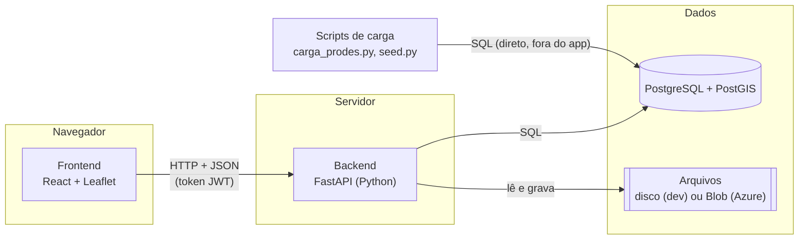
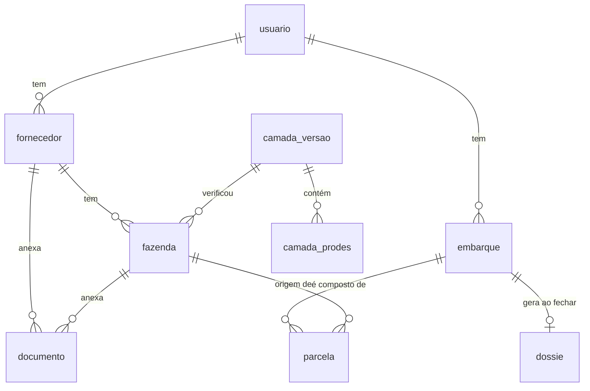
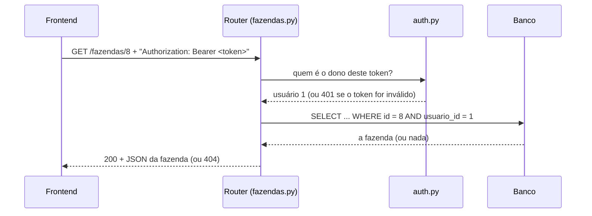
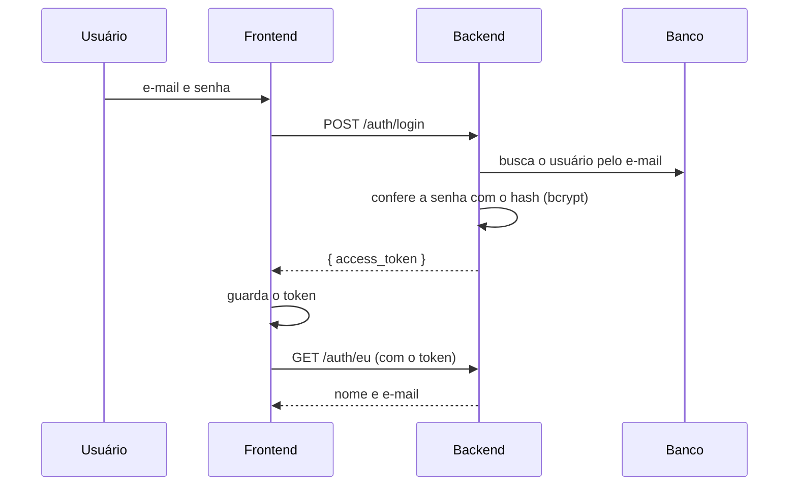
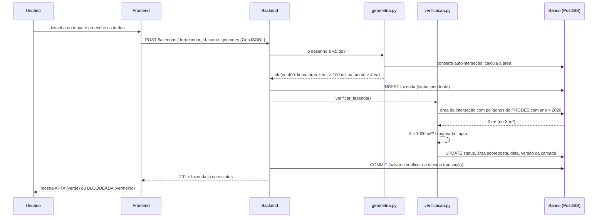
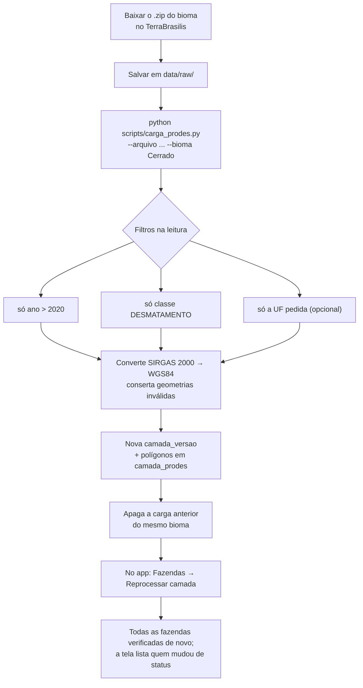
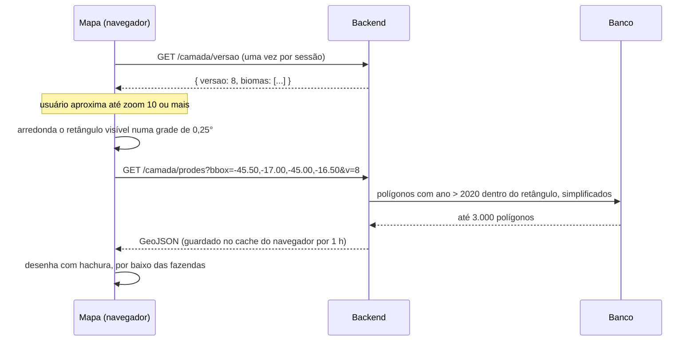
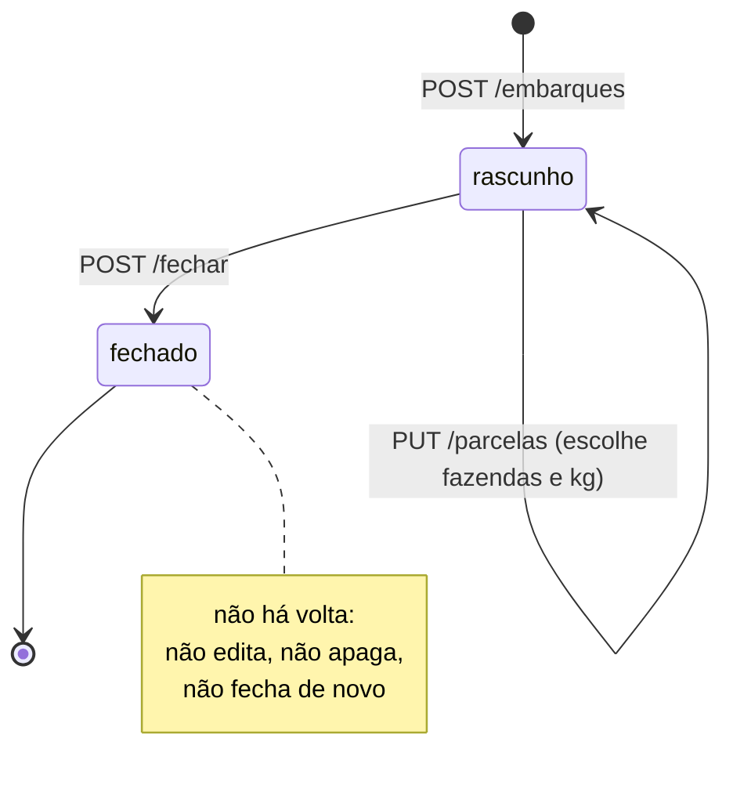

# Como o OrigemCheck funciona

Guia para entender o sistema de ponta a ponta: o que ele faz, como as partes conversam, o que acontece em cada
fluxo e o que já está pronto. As regras de negócio completas ficam em [context.md](../context.md); este documento
explica **como** elas viraram código.

> Situação descrita: outubro de 2026, branch `importa-trabalho-colaboradora`.

---

## Sumário

1. [O problema que o sistema resolve](#1-o-problema-que-o-sistema-resolve)
2. [Vocabulário](#2-vocabulário)
3. [Visão geral: as três partes](#3-visão-geral-as-três-partes)
4. [O banco de dados](#4-o-banco-de-dados)
5. [O backend](#5-o-backend)
6. [O frontend](#6-o-frontend)
7. [Os fluxos, passo a passo](#7-os-fluxos-passo-a-passo)
8. [As regras de negócio e onde elas moram no código](#8-as-regras-de-negócio-e-onde-elas-moram-no-código)
9. [Rodando localmente x rodando no Azure](#9-rodando-localmente-x-rodando-no-azure)
10. [O que está feito, o que foi verificado e o que falta](#10-o-que-está-feito-o-que-foi-verificado-e-o-que-falta)
11. [Onde mexer para…](#11-onde-mexer-para)

---

## 1. O problema que o sistema resolve

A partir de 30/12/2026, quem importa café para a União Europeia precisa provar, **para cada carga**, que o café não
veio de área desmatada depois de **31/12/2020** (Regulamento UE 2023/1115, a EUDR). O importador europeu repassa
essa exigência ao exportador brasileiro, que hoje controla isso em planilha e e-mail.

O OrigemCheck faz três coisas para o exportador:

1. **Cadastra** de onde vem o café: fornecedores e suas fazendas, com o desenho da área no mapa.
2. **Verifica sozinho** se cada fazenda tem desmatamento posterior a 2020, cruzando o desenho com o mapa oficial de
   desmatamento do INPE (PRODES).
3. **Gera a prova** de cada embarque: um dossiê com as fazendas de origem, em GeoJSON (para o sistema do importador)
   e em PDF (para leitura humana).

---

## 2. Vocabulário

| Termo | O que significa aqui |
|---|---|
| **Exportador / usuário** | Quem usa o sistema. Cada conta é um exportador e só enxerga os próprios dados. |
| **Fornecedor** | Produtor ou cooperativa que vende café ao exportador. Identificado por CPF ou CNPJ. |
| **Fazenda** | Área produtiva de um fornecedor, **com desenho no mapa** (polígono, ou ponto se tiver até 4 ha). É ela que é verificada. |
| **Parcela** | Uma parte de um embarque: "X kg vieram da fazenda Y". Cada parcela vem de uma única fazenda. |
| **Embarque** | Uma remessa para a UE, composta de parcelas. Nasce como rascunho e é fechado uma única vez. |
| **Dossiê** | A prova de origem de um embarque fechado: um retrato congelado dos dados daquele dia. |
| **PRODES** | Mapeamento anual de desmatamento do INPE. Cada polígono diz onde e em que ano houve supressão de vegetação. |
| **Camada** | O conjunto de polígonos do PRODES carregado no banco. Cada carga gera uma **versão**. |
| **CAR** | Cadastro Ambiental Rural; o código do imóvel rural. |
| **Status da fazenda** | `apta` (pode compor embarque), `bloqueada` (sobrepõe desmatamento pós-2020) ou `pendente`. |
| **GeoJSON** | Formato de texto para desenhos no mapa. É a "língua" que frontend e backend usam para geometrias. |
| **SRID 4326** | O sistema de coordenadas usado em todo o sistema: longitude e latitude em graus (WGS84). |

---

## 3. Visão geral: as três partes



Uma forma simples de pensar:

- **Frontend** é a vitrine. Mostra telas, desenha o mapa, recolhe o que o usuário digita. **Não decide nada
  importante**: não sabe se uma fazenda está apta, só exibe o que o backend respondeu.
- **Backend** é o balcão. Recebe cada pedido, confere quem está pedindo, aplica as regras (verificação, bloqueio,
  dossiê) e conversa com o banco. **Toda regra de negócio mora aqui.**
- **Banco de dados** é o arquivo. Guarda tudo, e com a extensão **PostGIS** também sabe fazer contas geográficas
  (área, interseção de polígonos). É ele quem calcula a sobreposição com o desmatamento.
- **Scripts de carga** rodam no terminal, fora do app, para colocar dados grandes no banco (a camada do PRODES e os
  dados de demonstração).

Frontend e backend só conversam por **HTTP com JSON**. O frontend nunca fala direto com o banco.

---

## 4. O banco de dados

### 4.1 As tabelas e como se relacionam



Lendo o diagrama: um usuário tem vários fornecedores; um fornecedor tem várias fazendas; um embarque tem várias
parcelas, e cada parcela aponta para **uma** fazenda; um embarque fechado tem **um** dossiê.

| Tabela | Guarda | Campos que importam |
|---|---|---|
| `usuario` | As contas | e-mail único, senha **criptografada** (bcrypt) |
| `fornecedor` | Produtores e cooperativas | CPF/CNPJ (validado, único por conta), PF/PJ, contato |
| `fazenda` | As áreas produtivas | `geom` (o desenho), `status`, `area_sobreposta_m2`, `verificada_em`, `camada_versao_id`, CAR, CCIR, NIRF, matrícula |
| `documento` | Anexos | pertence a um fornecedor **ou** a uma fazenda; tipo, validade, `sha256` do arquivo |
| `camada_versao` | Cada carga do PRODES | bioma, UF, arquivo de origem, quantas feições |
| `camada_prodes` | Os polígonos de desmatamento | `geom`, `ano`, `versao_id` |
| `embarque` | As remessas | `status` (`rascunho` ou `fechado`), destino, data |
| `parcela` | Itens do embarque | `fazenda_id`, `quantidade_kg` |
| `dossie` | A prova congelada | `retrato` (JSON com tudo copiado), caminhos do GeoJSON e do PDF |

### 4.2 Por que PostGIS

Uma coluna `geom` não guarda texto: guarda uma **geometria**. Com isso o banco responde perguntas como "este desenho
encosta naquele?" (`ST_Intersects`) ou "qual a área da parte em comum?" (`ST_Area(ST_Intersection(...))`).

Duas coisas tornam isso rápido e correto:

- **Índices espaciais (GiST)** em `fazenda.geom` e `camada_prodes.geom`. Com 863 mil polígonos de desmatamento, o
  índice faz o banco olhar só os polígonos perto da fazenda em vez de todos. Medido: 6 a 161 ms por fazenda.
- **O cast `::geography`** no cálculo de área. Sem ele, a área sai em "graus ao quadrado" (um número como 0,0003 que
  não significa nada). Com ele, sai em m².

### 4.3 Quem cria as tabelas

Só as **migrações do Alembic** (`backend/alembic/versions/`). Nunca se altera tabela direto no banco. Para criar
tudo do zero: `alembic upgrade head`.

### 4.4 Garantias que o próprio banco dá

Algumas regras estão no banco, não só no código, para não haver dado inconsistente nem por engano:

- Uma fazenda só pode apontar para um fornecedor **do mesmo usuário** (chave estrangeira composta).
- Um documento pertence a **exatamente um** dono (fornecedor ou fazenda).
- Status só aceita `pendente`, `apta`, `bloqueada`; quantidade de parcela tem de ser maior que zero.
- Uma fazenda usada em embarque **não pode ser apagada**.

---

## 5. O backend

### 5.1 Tecnologia e organização

FastAPI (Python 3.13), SQLAlchemy para falar com o banco, Pydantic para validar o que chega.

```
backend/app/
├─ main.py          liga tudo: cria o app, CORS, registra os routers
├─ config.py        lê as configurações do .env (banco, JWT, tolerância, storage)
├─ database.py      conexão com o banco (pool de conexões)
├─ models.py        as tabelas, em Python
├─ schemas.py       o formato do JSON que entra e sai (e as validações, como CPF/CNPJ)
├─ auth.py          senha (bcrypt) e token (JWT)
├─ routers/         uma "porta" por assunto: auth, fornecedores, fazendas, documentos, embarques, dossies, camada
└─ services/        a lógica que não é só "salvar e devolver"
   ├─ geometria.py     valida e conserta o desenho recebido
   ├─ verificacao.py   a checagem contra o PRODES
   ├─ dossie.py        monta o retrato, o GeoJSON e o PDF
   └─ arquivos.py      grava e lê arquivos (disco ou Azure Blob)
```

A divisão **router x service** é proposital: o router cuida do HTTP (o que chegou, quem é o usuário, que código de
erro devolver); o service cuida da regra. Por isso a verificação é chamada do mesmo jeito ao criar, editar, importar
ou reprocessar uma fazenda: todos chamam `verificar_fazenda()`.

### 5.2 O caminho de uma requisição

Exemplo: o frontend pede `GET /fazendas/8`.



Repare no `AND usuario_id = 1`: **toda** consulta filtra pelo dono. Se a fazenda 8 for de outra conta, a resposta é
404, como se não existisse (regra R6).

### 5.3 A API completa

Documentação interativa em `http://localhost:8000/docs` quando o backend está rodando.

| Área | Endpoints |
|---|---|
| Saúde | `GET /health`, `GET /health/db` |
| Conta | `POST /auth/registrar`, `POST /auth/login`, `GET /auth/eu` |
| Fornecedores | `GET/POST /fornecedores`, `GET/PUT/DELETE /fornecedores/{id}` |
| Fazendas | `GET/POST /fazendas`, `GET/PUT/DELETE /fazendas/{id}`, `POST /fazendas/import-geojson`, `POST /fazendas/{id}/verificar`, `POST /fazendas/reverificar` |
| Documentos | `GET/POST /fornecedores/{id}/documentos`, `GET/POST /fazendas/{id}/documentos`, `GET /documentos/{id}/arquivo`, `DELETE /documentos/{id}` |
| Embarques | `GET/POST /embarques`, `GET/PUT/DELETE /embarques/{id}`, `PUT /embarques/{id}/parcelas`, `POST /embarques/{id}/fechar` |
| Dossiês | `GET /dossies`, `GET /dossies/{id}`, `GET /dossies/{id}/geojson`, `GET /dossies/{id}/pdf` |
| Camada (mapa) | `GET /camada/versao`, `GET /camada/prodes?bbox=oeste,sul,leste,norte` |

Erros sempre voltam em português, dizendo o que falhou e o que fazer (por exemplo, 400 "Fazendas que não estão
aptas não podem compor o embarque: Sítio X (id 9, bloqueada)").

---

## 6. O frontend

### 6.1 Tecnologia e organização

React 18 + TypeScript, montado com Vite; Tailwind para o visual (estrutura shadcn); React-Leaflet para o mapa;
React Query para buscar dados; React Hook Form para formulários.

```
frontend/src/
├─ main.tsx            ponto de partida: configura o React Query e as rotas
├─ App.tsx             a lista de telas (rotas) e a proteção por login
├─ lib/
│  ├─ api.ts           o único lugar que faz fetch: põe o token, trata erros, faz downloads
│  ├─ auth.tsx         guarda o token e sabe quem está logado
│  ├─ consultas.ts     "perguntas" ao backend (useFazendas, useEmbarque...) com cache
│  ├─ tipos.ts         o formato dos dados que vêm da API
│  └─ formato.ts       hectares, kg, datas, CPF/CNPJ no padrão brasileiro
├─ components/
│  ├─ ui/fazendas-board.tsx          o quadro principal: lista com filtros + mapa
│  ├─ ui/fazendas-board-utils/mapa.tsx  mapa base, camada de desmatamento, fazenda colorida por status
│  ├─ editor-geometria.tsx           desenhar polígono ou ponto clicando no mapa
│  └─ documentos.tsx                 lista, envio e download de anexos
└─ pages/              uma tela por rota
```

### 6.2 As telas

| Rota | Tela | O que dá para fazer |
|---|---|---|
| `/login` | Login | Entrar ou criar conta |
| `/fazendas` | **Quadro de fazendas** | Lista filtrável por status + mapa com as fazendas e o desmatamento; importar GeoJSON; reprocessar a camada |
| `/fazendas/nova` | Nova fazenda | Desenhar no mapa e preencher os dados; ao salvar, a verificação já roda |
| `/fazendas/:id` | Detalhe | Status em destaque, dados, redesenhar, reprocessar, documentos |
| `/fornecedores`, `/fornecedores/:id` | Fornecedores | Cadastro, fazendas do fornecedor, documentos |
| `/embarques`, `/embarques/:id` | Embarques | Compor parcelas (fazendas bloqueadas aparecem desabilitadas, com o motivo), fechar, baixar evidências |
| `/dossies`, `/dossies/:id` | Dossiês | Auditoria: o retrato congelado, com mapa e downloads |

### 6.3 Como o frontend conversa com o backend

- **Endereço da API:** variável `VITE_API_URL` (`frontend/.env`). Localmente, `http://localhost:8000`.
- **Login:** o backend devolve um **token JWT**. O frontend guarda no navegador e manda em toda requisição, no
  cabeçalho `Authorization: Bearer ...`. Se o backend responder 401 (token vencido), o frontend volta para o login.
- **Cache:** o React Query guarda as respostas por 5 minutos e não repete a consulta só porque a janela ganhou foco.
  Quando algo muda (salvar uma fazenda, por exemplo), ele "invalida" as listas afetadas e busca de novo.
- **Downloads** (documentos, PDF, GeoJSON) precisam do token, então são feitos por `api.baixar()`, que busca o
  arquivo e entrega ao navegador; um link simples não funcionaria.

### 6.4 As cores dizem o status

Status codificado em **cor do traço** do desenho no mapa, nunca só em texto (o sócio que consulta pelo celular
precisa entender em dois segundos):

- verde: apta;
- vermelho: bloqueada;
- cinza tracejado: pendente;
- círculo com anel tracejado: fazenda marcada por ponto (até 4 ha);
- hachura vermelha diagonal, **por baixo** das fazendas: desmatamento pós-2020 do PRODES (dá para desligar).

---

## 7. Os fluxos, passo a passo

### 7.1 Entrar no sistema



A senha nunca é guardada nem trafega de volta: o banco só tem o hash.

### 7.2 Cadastrar uma fazenda (e a verificação automática)

Este é o coração do sistema.



Detalhes que valem entender:

- **Salvar e verificar acontecem na mesma transação.** Se a verificação falhar, a fazenda não fica salva. Nunca
  existe fazenda "cadastrada mas não verificada" escondida (regra R1).
- **Tolerância de 1.000 m²** (`TOLERANCIA_M2`): sobreposições pequenas costumam ser imprecisão de desenho na borda e
  não bloqueiam. A área sobreposta fica registrada mesmo assim.
- **Fazenda em ponto** não tem área, então o critério é binário: o ponto cai dentro de um polígono de desmatamento?
  Se sim, bloqueada. A tolerância não se aplica.
- **Camada vazia:** se não houver PRODES carregado, a verificação **recusa** (erro 503) em vez de aprovar tudo.
- **Editar a geometria** (`PUT`) roda a verificação de novo. Editar só o nome, não.
- **Importar GeoJSON** faz o mesmo para cada feição, em bloco: se uma falhar, nenhuma é gravada.

A consulta central, simplificada:

```sql
SELECT COALESCE(SUM(ST_Area(ST_Intersection(f.geom, d.geom)::geography)), 0)
FROM fazenda f
JOIN camada_prodes d ON ST_Intersects(f.geom, d.geom)   -- o índice GiST entra aqui
WHERE f.id = :id AND d.ano > 2020;
```

### 7.3 Carregar o desmatamento (PRODES) e reprocessar

O PRODES não entra pela tela: é grande demais. Entra por script, no terminal.



Por que o **Reprocessar** existe: a verificação automática roda quando a fazenda é salva. Uma camada nova não
reverifica sozinha as fazendas antigas, porque a carga acontece fora do app. O botão faz isso.

Hoje estão carregados os seis biomas, todos os estados: **863.255 polígonos** de 2021 a 2026 (735 MB). Ver
[context.md §10](../context.md) para os detalhes do arquivo e a lacuna da Amazônia.

### 7.4 O mapa e a camada de desmatamento

Mostrar 863 mil polígonos de uma vez travaria o navegador e gastaria muitas requisições. Então o mapa busca **só o
que está na tela**:



- **Afastado** (zoom menor que 10), o mapa não pede nada e avisa "Aproxime o mapa".
- **O `v=8` na URL** muda quando há carga nova; assim o navegador não reaproveita a camada antiga do cache.
- **Recorte arredondado:** mexer pouco o mapa reaproveita a resposta anterior.

### 7.5 Documentos

1. Na fazenda ou no fornecedor, o usuário escolhe o tipo (CAR, CCIR, matrícula, licença, contrato), a validade e o
   arquivo.
2. O backend confere o **conteúdo** do arquivo (PDF, PNG ou JPG), não só o nome, e o limite de 10 MB.
3. Calcula o **SHA-256** (uma "impressão digital" do arquivo) e grava o arquivo:
   - localmente, em `backend/storage/`;
   - no Azure, no **Blob Storage** (o disco da Function não é permanente).
4. Guarda no banco só os dados do documento e onde o arquivo está.

O SHA-256 vai para o dossiê: se alguém trocar o arquivo depois, dá para provar que não é o mesmo.

### 7.6 Embarque, fechamento e dossiê



1. **Criar** o embarque (identificação, data, destino). Nasce como rascunho.
2. **Compor** as parcelas: para cada fazenda, quantos kg. O **backend** recusa com 400 qualquer fazenda que não esteja
   apta e diz quais são (regra R2). Na tela, as bloqueadas aparecem desabilitadas com o motivo, mas quem decide é o
   servidor.
3. **Fechar.** O backend:
   - confere de novo se todas continuam aptas (alguém pode ter reprocessado a camada no meio);
   - **copia** para o dossiê tudo o que importa naquele instante: desenhos, CAR, status, área sobreposta, data da
     verificação, versão da camada, quantidades, documentos com SHA-256;
   - gera o **GeoJSON** e o **PDF** e guarda os arquivos;
   - marca o embarque como fechado.

**Por que copiar em vez de só apontar para as fazendas (regra R3):** se o PRODES for atualizado em junho e uma
fazenda virar bloqueada, o dossiê de abril precisa continuar mostrando o que se sabia em abril. É uma prova; se
mudasse sozinho, deixaria de servir como prova. Há um teste que verifica exatamente isso.

---

## 8. As regras de negócio e onde elas moram no código

| Regra | Em uma frase | Onde está |
|---|---|---|
| **R1** Verificação automática | Salvar ou mudar o desenho já verifica; não existe fazenda "não verificada" | `services/verificacao.py`, chamado de `routers/fazendas.py` |
| **R2** Bloqueio no servidor | Fazenda não apta não entra em embarque; erro 400 com os nomes | `validar_fazendas_aptas()` em `routers/embarques.py` |
| **R3** Dossiê congelado | O dossiê copia os dados do dia do fechamento | `services/dossie.py` (`montar_retrato`) |
| **R4** Ponto até 4 ha | Ponto só para áreas pequenas; critério binário | `services/geometria.py` e `services/verificacao.py` |
| **R5** Tolerância | Sobreposição abaixo de 1.000 m² não bloqueia | `TOLERANCIA_M2` em `config.py`, usada em `verificacao.py` |
| **R6** Cada um vê o seu | Toda consulta filtra pelo usuário; recurso alheio dá 404 | Todos os routers (`usuario_id`) e as chaves compostas no banco |

---

## 9. Rodando localmente x rodando no Azure

O **mesmo código** roda nos dois lugares; o que muda é quem o hospeda e onde os arquivos ficam.

| | Local (desenvolvimento) | Azure (produção) |
|---|---|---|
| Frontend | `npm run dev` (porta 5173) | Static Web Apps (plano gratuito) |
| Backend | `uvicorn app.main:app` (porta 8000) | **Azure Functions**, plano Flex Consumption, Python 3.13 |
| Banco | PostgreSQL + PostGIS no Docker (porta 5433) | Azure Database for PostgreSQL (B1ms) |
| Arquivos | `backend/storage/` (disco) | Blob Storage (`STORAGE_BACKEND=blob`) |
| Configuração | arquivo `.env` | configurações do aplicativo no Azure |

**Como o FastAPI vira uma Function:** o arquivo `backend/function_app.py` "embrulha" o app FastAPI. O Azure entrega
cada requisição a esse embrulho, que repassa ao FastAPI. As rotas são as mesmas, sem o prefixo `/api`.

**Por que Functions:** o plano gratuito do App Service estourava. No Functions paga-se por execução, com uma cota
gratuita mensal (250 mil execuções no Flex). Daí alguns cuidados no código:

- cada requisição é uma execução, então o frontend usa cache e não fica perguntando repetidamente;
- o preflight de CORS (um pedido `OPTIONS` que o navegador faz antes das requisições com token) também conta; o
  backend pede ao navegador para guardar a resposta por 2 horas;
- cada instância da Function abre poucas conexões com o banco (pool de 3 + 2), para não esgotar o PostgreSQL.

Comandos de provisionamento: `infra/azure-functions.sh`. Pipeline: `.github/workflows/backend.yml`.

### Como rodar localmente

```bash
# Terminal 1: banco e backend
cd ~/Desktop/Sistema-Rastreabilidade-EUDR
docker compose up -d
cd backend && source .venv/bin/activate
uvicorn app.main:app --reload

# Terminal 2: frontend
cd ~/Desktop/Sistema-Rastreabilidade-EUDR/frontend
npm run dev
```

Abrir `http://localhost:5173`. Conta de demonstração: `demo@exemplo.com.br` / `demo-origemcheck-2026`.

---

## 10. O que está feito, o que foi verificado e o que falta

### Pronto e verificado

| O quê | Como foi verificado |
|---|---|
| Cadastro de fornecedores (CPF/CNPJ validado), fazendas e documentos | Testes automáticos + uso no navegador |
| Verificação automática com tolerância, ponto até 4 ha e recusa sem camada | Testes com camada sintética de área conhecida |
| Bloqueio no servidor e dossiê congelado (GeoJSON + PDF) | Testes, incluindo "PRODES mudou e o dossiê não" |
| Isolamento entre contas | Testes com dois usuários |
| Importação de GeoJSON (tudo ou nada) | Testes |
| Frontend completo, incluindo o roteiro da demonstração (desenhar sobre desmatamento, ver bloquear, ver a recusa no embarque, fechar, abrir o dossiê) | Navegador automatizado, sem erros no console |
| Carga do PRODES direto do `.zip` com recorte por UF, classe e ano | Testes + carga real dos seis biomas (863 mil polígonos) |
| Ponte com o Azure Functions (rotas, CORS, upload binário) | Testes que passam pelo mesmo middleware que o Azure usa |
| Storage no Blob | Testes com um contêiner simulado |

No total, **75 testes automáticos do backend**, rodando contra um banco de teste separado (`eudr_test`).

### Ainda não verificado

- **Deploy no Azure:** nunca foi executado. O script `infra/azure-functions.sh` e o workflow do GitHub foram escritos,
  mas não rodaram (a CLI do Azure não estava disponível).
- **Blob Storage real:** só testado com simulação.
- **`func start`** (rodar como Function na máquina): o Azure Functions Core Tools não está instalado.
- **Frontend:** não tem testes automáticos, nem build no pipeline.

### Falta fazer / pontos de atenção

- **Amazônia:** só o preliminar de 2026 está carregado; falta o histórico 2021–2025.
- **Reprocessar camada** depois das cargas novas (as fazendas de demonstração ainda apontam para a versão antiga).
- **`JWT_SECRET`:** trocar antes do deploy (o valor padrão é inseguro).
- **React Router:** dois alertas de segurança moderados que só se resolvem na versão 7 (não afetam este app hoje).
- **Fora do escopo por decisão** (ver `context.md` §3): mistura de cargas/balanço de massa, outras camadas (Ibama,
  terras indígenas), portal do importador, IA/OCR.

---

## 11. Onde mexer para…

| Quero… | Arquivo |
|---|---|
| Mudar a regra de verificação | `backend/app/services/verificacao.py` |
| Mudar o que é aceito como geometria | `backend/app/services/geometria.py` |
| Mudar o conteúdo do dossiê ou do PDF | `backend/app/services/dossie.py` |
| Criar ou alterar tabela | `backend/app/models.py` + nova migração em `backend/alembic/versions/` |
| Criar endpoint | um arquivo em `backend/app/routers/` + registrar em `main.py` |
| Mudar cores e legenda do mapa | `frontend/src/lib/status.ts` e `components/ui/fazendas-board-utils/mapa.tsx` |
| Mudar o quadro de fazendas | `frontend/src/components/ui/fazendas-board.tsx` |
| Criar tela | `frontend/src/pages/` + rota em `App.tsx` |
| Carregar outra camada do PRODES | `python scripts/carga_prodes.py --help` |
| Recriar os dados de demonstração | `python scripts/seed.py` |
